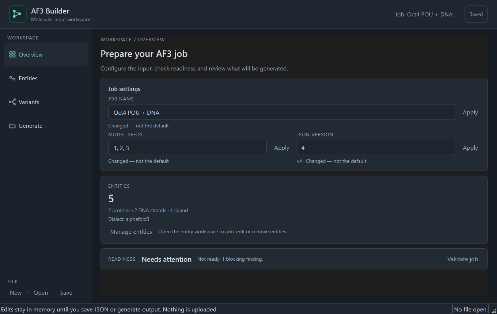
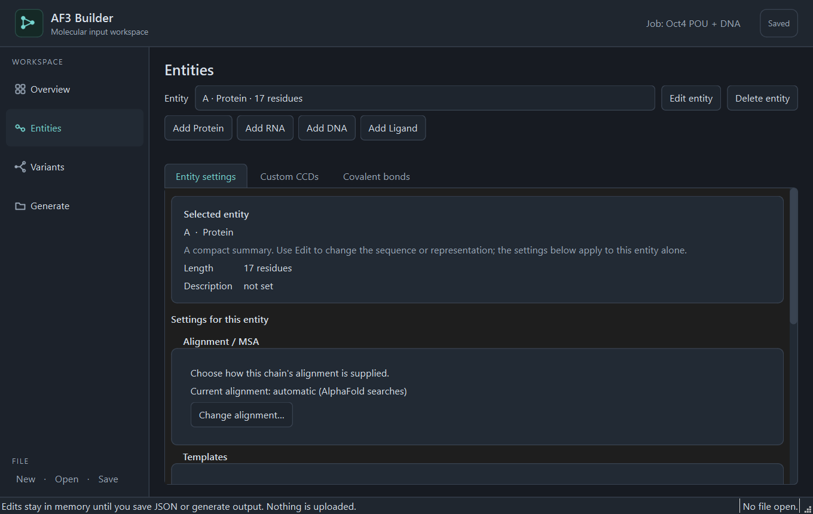
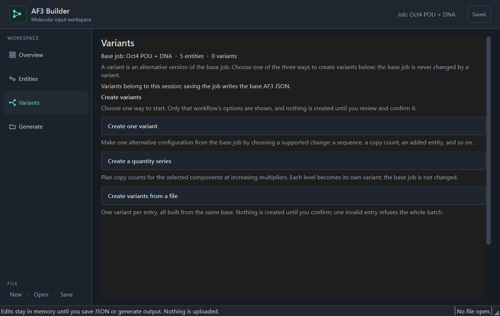
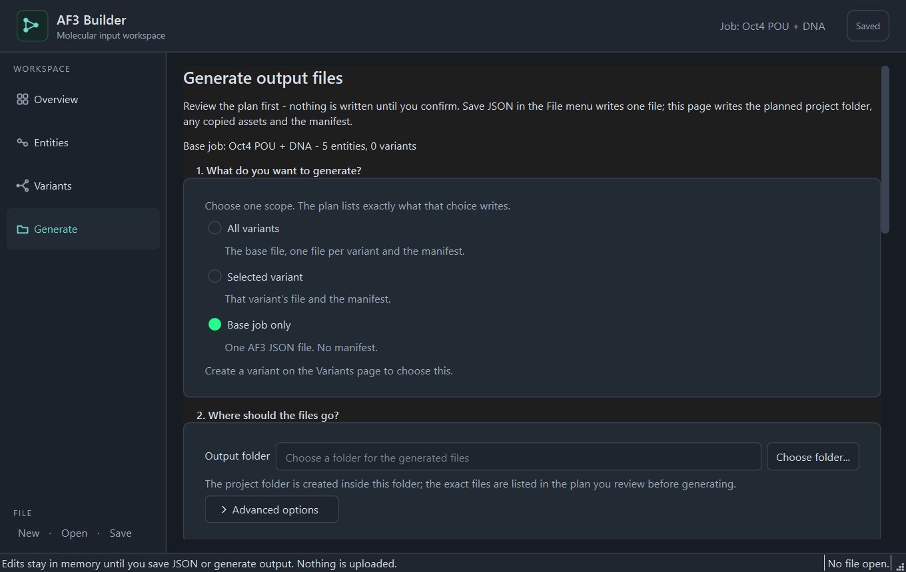
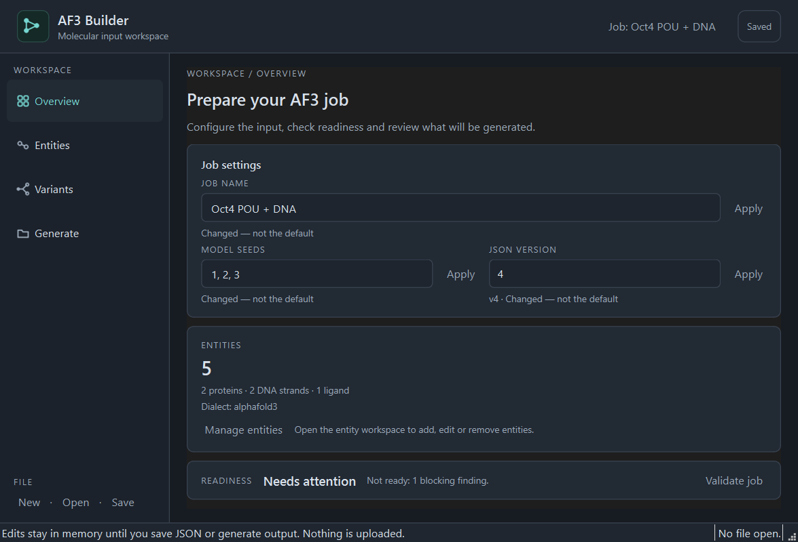

# GUI Workflow Simplification — Implementation Report

**Date:** 19 October 2026  
**Scope:** the focused UX pass requested in
`docs/AF3_GUI_WORKFLOW_SIMPLIFICATION_PROMPT.md`, plus the final visual/polish
corrections found while reviewing real 1360×860 and 940×640 captures.  
**Status:** implemented; GUI suite green. No domain, validation, serialization,
output-planning or file-writing rule was changed.

---

## 1. What changed, and why

The user's five complaints were:

1. the standalone JSON preview destination was redundant;
2. Generate & Output was cramped and exposed everything at once;
3. Variants & Batch was not intuitive and showed all workflows together;
4. Entities had an oversized preview and hid advanced settings in another tab;
5. the whole application should stay minimal, restrained and consistent with
   the approved mockup.

Each complaint maps to one focused change:

| Complaint | Change |
| --- | --- |
| Redundant raw JSON | Removed the **JSON preview** sidebar destination and the Overview **Preview JSON** shortcut. The document is still produced by `GenerationService.show_json`, still saved through the existing plan/execute path, and still exists internally for the window's own checks. |
| Cramped Generate page | Rebuilt as four numbered steps: scope → destination → review plan → generate. Only one scope list is shown, explained radio choices replace an opaque drop-down, and overwrite/path policies live under a collapsed **Advanced options** disclosure. |
| Unintuitive Variants page | The page opens on three explained choices — one variant, a quantity series, or variants from a file. Choosing one replaces the chooser with only that workflow and a **Back to choices** action. The existing-variants list and its edit actions sit below the chooser and are hidden until a variant exists. |
| Oversized Entities preview | The duplicated large preview is gone. The workspace is now a compact master/detail split: the table and add/edit/delete actions on the left, one scrollable column on the right with a short facts card followed by the same `AdvancedPage` instance that carries PTMs, MSA, templates, job-wide CCD and bonds. |
| Visual consistency | Shared stylesheet only: charcoal surfaces, one turquoise accent, consistent radii, spacing and control heights, quiet secondary actions and one primary action per page. |

The final review pass also fixed four concrete defects visible in the captures:

- **Readiness wording.** “Not ready: 1 blocking finding(s).” became
  “Not ready: 1 blocking finding.” via one `blocking_verdict(count)` helper;
  plural wording remains for two or more.
- **Entity fact rows.** A protein no longer shows an empty
  “Reverse-complement partner” row, and DNA no longer shows inapplicable MSA
  and template rows. Descriptions and modifications remain where they apply;
  a ligand keeps only its description because its representation is already
  the large field above.
- **Generate variant picker.** The “Which variant” row is hidden unless
  **Selected variant** is the active scope, instead of appearing disabled and
  empty under every scope.
- **Duplex summary wording.** The status service counts AF3 chain records, so a
  builder-created duplex is two records. The Overview now says
  “2 DNA strands” instead of the incorrect “2 DNA duplexes”. The big entity
  count remains the record count shown in the Entities table.
- **No duplicated menu strip.** The hidden menu bar left a clipped strip above
  the product header. The actions now live only in the FILE footer, with
  standard keyboard shortcuts, matching the mockup and the instruction not to
  duplicate New/Open/Save.

---

## 2. Navigation before and after

### Before

```
WORKSPACE
  Overview
  Entities
  Variants
  Generate
  JSON preview        ← redundant destination
FILE
  New · Open · Save
```

Overview also carried a **Preview JSON** button beside **Validate job**.

### After

```
WORKSPACE
  Overview
  Entities
  Variants
  Generate
FILE
  New · Open · Save
```

`PreviewPage` still exists as an internal, non-navigable view used by the
window's own checks; it is not in the sidebar and has no user-facing shortcut.
The FILE footer is the one visible home for New/Open/Save, with Ctrl+N/O/S as
shortcuts; the duplicated menu strip was hidden. Saving is routed through
`MainWindow.save_json` → `GenerationService.plan_save` / `execute`.

There is one job-settings implementation: the `JobSettingsPanel` hosted by
Overview. There is no separate Job Settings destination.

---

## 3. Page-level behaviour

### Overview

- Title and one explanatory sentence, then the single job-wide settings card
  (name, seeds, version) with Apply semantics and default/changed markers.
- Compact entity count plus per-family line and dialect.
- Readiness verdict and count come from `ValidationService.status()`; the page
  never recomputes readiness.
- One state-matched next step:
  - no entities → **Add at least one entity** + **Add entities**;
  - entities but blocking findings → **Review the blocking findings**;
  - ready → **Review the output plan** + **Open Generate**.
- Readiness rows and the validation-findings table stay on the page; selecting
  a finding still jumps to the entity it names.
- **Validate job** re-reads the service and reports the same verdict the cards
  show.

### Entities

- Compact table in configuration order (ID, family, length/representation).
- Add Protein / Add RNA / Add DNA / Add Ligand, plus Edit Selected and Delete
  Selected.
- One scrollable detail column: selected entity facts, then the entity's own
  settings.
- Family-specific disclosure:
  - protein → modifications, MSA, templates, partner row hidden;
  - RNA → modifications and MSA;
  - DNA → modifications and duplex partner, no MSA/templates;
  - ligand → description only; the advanced page states that a ligand has no
    entity-level settings.
- Job-wide CCD definition and covalent bonds remain inside the advanced view
  under their own heading, marked as whole-job settings.

### Variants

- Opens on three labelled choices with one sentence each.
- One workflow visible at a time, with **Back to choices**; leaving commits
  nothing.
- Quantity series and file batches preview their plan/parsed entries before
  creation.
- Existing variants appear below the chooser, with add-change, rename,
  duplicate, remove and validate actions acting on the selected variant.
- Base configuration is never mutated by a variant operation.

### Generate

1. **What do you want to generate?** — all variants, selected variant or base
   job only, each with a sentence; unsupported scopes are disabled and
   explained.
2. **Where should the files go?** — folder picker plus **Advanced options**
   (overwrite and path policies) collapsed by default.
3. **Review the plan** — Preview plan shows files, assets, warnings, conflicts
   and findings; nothing is written.
4. **Generate files** — explicit confirmation naming the destination and
   policies, a re-plan to prove the reviewed plan is current, then
   `GenerationService.execute`.

Conflicts and findings stay outside the disclosure. A job change or control
change invalidates the reviewed plan, so stale plans cannot be written.

---

## 4. Files

### Application code

| File | Change |
| --- | --- |
| `configbuilder/ui/render/qt/pages/overview.py` | Mockup control centre; singular/plural readiness verdict; DNA strand wording; preview shortcut removed. |
| `configbuilder/ui/render/qt/pages/entities.py` | Compact master/detail entity workspace; family-conditional fact rows; advanced settings embedded. |
| `configbuilder/ui/render/qt/pages/advanced.py` | Same advanced editor, now hosted in the entity workspace; family groups hidden when inapplicable. |
| `configbuilder/ui/render/qt/pages/variants.py` | Three-choice entry screen; one workflow at a time; chooser above the existing-variants list; empty list hidden. |
| `configbuilder/ui/render/qt/pages/generate.py` | Four-step guided plan/review/generate flow; collapsed advanced options; variant picker only for the selected scope. |
| `configbuilder/ui/render/qt/pages/settings.py` | The one job settings editor, hosted by Overview. |
| `configbuilder/ui/render/qt/pages/preview.py` | Kept as an internal view; no longer navigable. |
| `configbuilder/ui/render/qt/windows/main_window.py` | Four destinations; JSON preview removed from navigation; hidden menu strip replaced by FILE footer actions with standard shortcuts; immediate refresh of the pages from services. |
| `configbuilder/ui/render/qt/models.py` | Entity, variant, status and findings models; `counts_text` and row projections. |
| `configbuilder/ui/render/qt/style.py` | One shared dark workbench stylesheet and spacing scale. |
| `configbuilder/ui/present/strings.py` | New `gui.*` wording; `blocking_verdict` helper; DNA strand labels; generate placeholder. |

### Tests

Added `tests/gui/test_workflow_simplification.py` (navigation, entity
workspace, variants chooser, generate steps, final polish assertions) and
updated the existing GUI tests that read navigation, readiness wording,
generate controls, entity details, variant flow and window lifecycle:
`test_generate_output.py`, `test_mockup_shell.py`, `test_stage8_ux.py`,
`test_final_ux.py`, `test_window.py`, `test_advanced_settings.py`,
`test_readiness.py`, `test_import_flow.py`.

### Documentation and captures

- `RUNNING_THE_APPLICATION.md` — describes the four destinations and the
  current page behaviour.
- `docs/screenshots/overview_1360x860.png`
- `docs/screenshots/overview_940x640.png`
- `docs/screenshots/entities_protein_1360x860.png`
- `docs/screenshots/variants_choose_1360x860.png`
- `docs/screenshots/generate_1360x860.png`
- this report.

The captures were made by showing the real `MainWindow` with the **windows**
platform plugin and grabbing the widget. The offscreen plugin in this
environment exposes zero font families, so offscreen captures render every
glyph as a box and are not included.

---

## 5. Captures

### Overview, 1360×860



### Entities — protein selected



### Variants — first screen



### Generate — step 1–3



### Overview, minimum window size



---

## 6. Test commands and results

All commands were run from the repository root on Windows, 19 October 2026.

### GUI suite (offscreen)

```powershell
$env:QT_QPA_PLATFORM = "offscreen"
.\.venv-gui\Scripts\python.exe -m pytest -o addopts="" -q tests/gui
```

**Result:** `265 passed in 62.02s`.

### Focused workflow suite

```powershell
$env:QT_QPA_PLATFORM = "offscreen"
.\.venv-gui\Scripts\python.exe -m pytest -o addopts="" -q `
  tests/gui/test_workflow_simplification.py tests/gui/test_readiness.py `
  tests/gui/test_mockup_shell.py tests/gui/test_stage8_ux.py `
  tests/gui/test_import_flow.py tests/gui/test_entity_management.py
```

**Result:** `84 passed in 16.15s`.

### Core suite (no PySide6 required)

```powershell
python -m pytest -o addopts="" -q
```

**Result:** `1032 passed, 13 failed, 15 skipped, 1 warning in 99.92s`.

### Baseline vs current failures

Before this work, Stage 8 recorded **227 GUI passes** and
`1030 passed, 13 failed, 12 skipped` for the core suite. The 13 failures are
the same node IDs measured in Stages 6, 7 and 8: the retired numbered terminal
menu. They are unchanged by this pass and are not caused by the GUI:

```
tests/e2e/test_entity_lifecycle.py::test_every_family_survives_a_full_lifecycle
tests/e2e/test_entity_lifecycle.py::test_an_imported_document_is_editable_like_a_built_one
tests/e2e/test_entity_lifecycle.py::test_a_long_repeated_chain_of_operations_leaves_consistent_state
tests/e2e/test_menu_acceptance.py::test_a_blank_job_name_is_generated_by_the_service
tests/e2e/test_menu_acceptance.py::test_add_every_entity_family
tests/e2e/test_menu_acceptance.py::test_job_settings_change_name_seeds_and_version
tests/e2e/test_menu_acceptance.py::test_invalid_job_settings_are_refused_in_the_users_terms
tests/e2e/test_menu_acceptance.py::test_the_job_menu_numbering_is_stable_across_states
tests/e2e/test_menu_acceptance.py::test_the_entity_modifications_submenu_adds_edits_and_removes
tests/e2e/test_menu_acceptance.py::test_ptm_management_adds_edits_and_removes
tests/e2e/test_menu_acceptance.py::test_a_ligand_carries_no_modifications_and_is_told_so
tests/e2e/test_menu_acceptance.py::test_open_json_can_be_cancelled_at_the_confirm
tests/e2e/test_menu_acceptance.py::test_an_opened_job_can_be_edited_and_saved
```

No new failure was introduced. The GUI count rose from 227 to 265 because the
new workflow and polish assertions were added.

### Launch smoke tests

The application was started through the real GUI environment for the
screenshots (`MainWindow` over a service-built demo-like job). The launcher
tests (`tests/unit/test_launchers.py`) and the architecture/string-registry
checks run inside the core suite and pass. The known 13 e2e failures are the
terminal-menu scripts, not the launchers.

---

## 7. Known limitations and what still needs a human display

1. **Offscreen tests, not a human visual review.** The GUI suite runs with
   `QT_QPA_PLATFORM=offscreen`. The captures above use the **windows** plugin
   and real system fonts, but they are still automated `grab()` images. High
   DPI, display scaling, keyboard focus order, screen-reader labels and
   platform theme overrides still need a check on the user's own Windows
   desktop.
2. **The 13 terminal-menu end-to-end failures** are pre-existing and listed
   above. They script the retired numbered menu and are outside this GUI pass.
3. **Entity counts are chain counts.** The Overview's big number and the
   Entities table count AF3 `sequences` records: a builder-created DNA duplex
   is two records and therefore two rows. The summary now says “2 DNA strands”
   rather than calling the pair two duplexes. The mockup's “4 entities / 1 DNA
   duplex” therefore reads “5 entities / 2 DNA strands” for the same job. This
   is deliberate consistency with the table and the service, not a count bug.
4. **The mockup's contradictory sample state is not reproduced.** The reference
   image shows four entities and a next step that says “Add at least one
   entity”. The real page chooses its next step from the service state, so a
   job with entities says “Review the blocking findings” instead.
5. **Advanced workflows are still dense by nature.** The variant change
   editor and the quantity-series controls remain full-width forms; they are
   disclosed one at a time rather than simplified into a new wizard.
6. **Internal preview remains.** Serialization and preview are still available
   to code and tests; only the user-facing destination and shortcut were
   removed. No serialization behaviour was changed.

---

## 8. Manual Windows acceptance checklist

- [ ] Start `python gui.py`; confirm the sidebar has exactly Overview,
      Entities, Variants, Generate and a FILE footer with New · Open · Save.
      Confirm there is no JSON preview destination or Preview JSON button.
- [ ] Open `python gui.py --demo`; confirm the job name, seed values and version
      appear on Overview and that the sidebar destinations are all populated.
- [ ] Add a protein; select it and confirm its sequence, description,
      modifications, MSA and templates are visible in the same right-hand
      column, with no reverse-complement row.
- [ ] Add DNA; confirm the duplex partner row appears and MSA/templates do not.
      Add a ligand; confirm only its representation and description apply.
- [ ] On Variants, confirm the page opens on the three choices (not a wall of
      controls), and that the existing-variants list is hidden while empty.
      Create one variant, a series, and a file batch; verify each previews
      before committing and **Back to choices** creates nothing.
- [ ] On Generate, confirm the four numbered steps, collapsed **Advanced
      options**, and that the variant picker appears only for **Selected
      variant**. Preview a plan, cancel once and confirm no files were written;
      then generate to a temporary folder and inspect the result.
- [ ] Resize to the minimum window size and maximize; confirm long paths,
      sequences and the three variant choices remain readable and scrollable.
- [ ] Toggle keyboard focus through the sidebar, forms and buttons; confirm
      focus is visible and disabled controls are distinguishable.
- [ ] Confirm `python af3builder.py` still starts the console builder.
