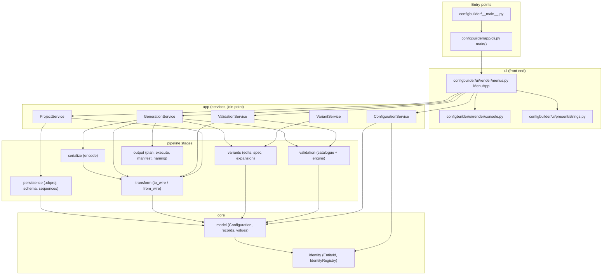
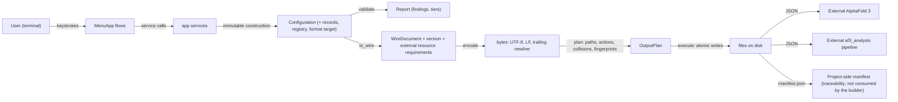
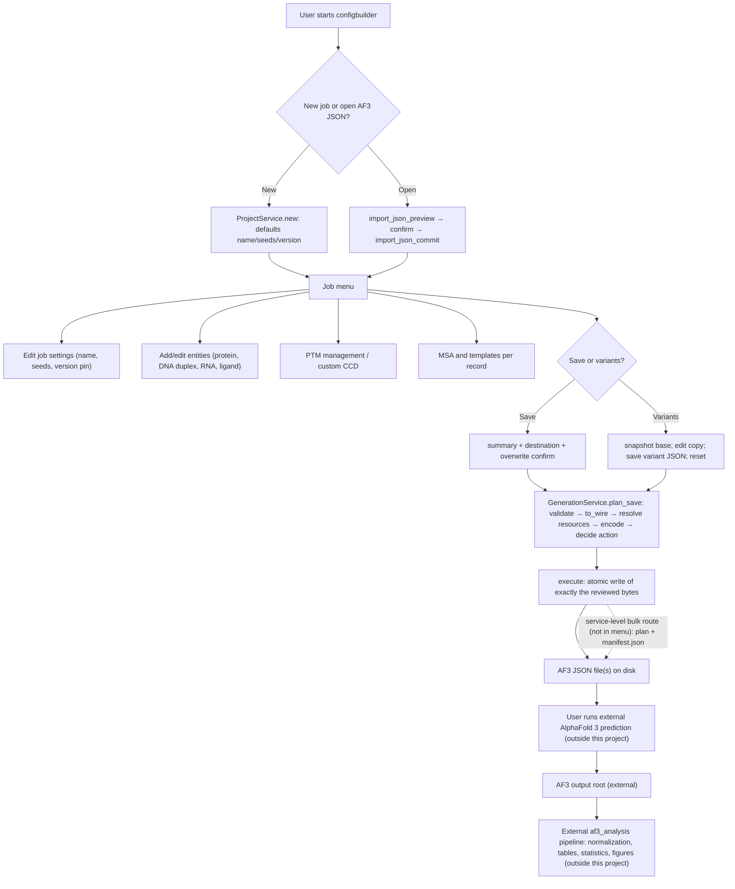

# IMPLEMENTATION_MAP — `configbuilder` (AlphaFold 3 Input Builder)

> **What this document is.** A map of the implementation of the AlphaFold 3 (AF3) input
> builder in this repository (`configbuilder`), written to support the Implementation
> chapter of a thesis. It is based on inspection of the working tree as it stands on
> **2026-10-11** (Windows, CPython 3.11.15, package installed editable from this
> checkout), on fresh test runs executed during this audit, and on the project's own
> design/contract documents. Every non-obvious claim carries a source reference such
> as `configbuilder/app/cli.py:25`.
>
> **Verification status of this audit.** The full test suite and the external AF3
> parser-validation harness were executed during this audit (commands and results in
> §9 and §14). The repository contains uncommitted modifications to the builder and
> its tests (the menu rework and audit repairs); this document describes that working
> tree, not the last commit.
>
> **Citation convention.** Citations are repository-relative paths. Paths that are not
> in this repository are marked as external (the AlphaFold 3 sources, the separate
> `af3_analysis` package) or are generated artifact names (for example `manifest.json`).
>
> **Graphify note.** The task asked to use Graphify as a supporting analysis tool. The
> Graphify MCP server was reachable but **returning HTTP 503 `migration_standby`**
> ("Service is waiting for migration cutover") on 2026-10-11, both at the start and on
> a later retry; no graph could be listed or resolved. The architecture picture below
> therefore comes from the source itself (import scanning, function indexing, and
> execution traces), which is the same evidence Graphify would have indexed. This
> limitation is recorded rather than hidden.

---

## 1. Project overview

### 1.1 What problem the project solves

AlphaFold 3 (AF3) consumes standalone input in a documented JSON dialect
(`AUTHORITATIVE_SPEC.md` §4, citing AF3 `docs/input.md` and
`src/alphafold3/common/folding_input.py` — both paths inside the external AlphaFold 3
repository, not this one). Hand-writing such files is error-prone:
identifiers must be unique and format-valid, each entity family has its own
representation rules, post-translational modifications must reference real residue
positions, external files (MSAs, templates, custom CCD) must exist and travel with the
job, and a single typo can make an expensive prediction run fail after the fact.

`configbuilder` is a **terminal application that builds, validates, and writes
standalone AF3 input JSON files** and their companions. It is a pure-Python package
declared in `pyproject.toml` with **zero runtime dependencies**
(`dependencies = []`, `requires-python = ">=3.9"`) and one console entry point
(`configbuilder = "configbuilder.app.cli:main"`).

The software's self-description in `pyproject.toml` is: *"Terminal builder that
produces validated, reproducible standalone AF3 input files."*

### 1.2 Why programmatic generation is useful

- **Validation before cost.** The builder runs a 44-rule catalogue (§7) before any
  file is written, and refuses to write when a blocking finding is present.
- **Identity discipline.** Every entity identifier is allocated and reserved through a
  registry, so duplicates are refused rather than silently emitted
  (`configbuilder/identity/registry.py`).
- **Reproducibility.** Serialization is byte-deterministic (UTF-8, LF only, fixed
  separators, no timestamps); golden fixtures and determinism tests rely on this
  (`configbuilder/serialize/encode.py:61`, `tests/golden/`, `tests/serialization/`).
- **Variants and traceability.** Controlled changes over a base job produce independent
  files plus a manifest that records base fingerprint, per-variant edits, and content
  fingerprints (`configbuilder/output/manifest.py:67`).
- **Specification conformance.** Emitted documents are checked against AF3's own parser
  by a separate harness (PASS on 2026-10-11, §9.4).

### 1.3 Inputs and outputs

| | Content |
|---|---|
| **User inputs** | Job name, model seeds, template/format choices; molecular entities: protein/RNA/DNA sequences, ligand CCD codes or SMILES, copy counts; residue modifications (PTM code + 1-based position); MSA mode and source (automatic/free, inline text, or external file); template references (inline or external file, 0-based index pairs); an optional custom CCD definition (inline CIF text or a file); variant edits; file paths. |
| **Software outputs** | One AF3 JSON document per generated job (base and/or per variant), optional copied external resources under `assets/`, and a `manifest.json` for variant runs. Project files (`.cbproj`) are a service-level persistence format; the user-facing save writes AF3 JSON. |
| **Consumed by** | The external AlphaFold 3 environment (separately installed by the user) and, downstream, the external AF3 confidence-analysis pipeline (a separate project; §10). |

### 1.4 Main software contribution vs downstream workflow

**Main contribution (this repository):** the builder — canonical model, identity
registry, validation catalogue, transformation and serialization, output planning and
execution, variant system, persistence, terminal front end, plus its offline AF3
parser-validation harness.

**Secondary/adjacent:**
- **External prediction** by AlphaFold 3 itself. The builder does **not** implement the
  AF3 model, does not run predictions, does not featurize, and does not generate MSAs.
- **External analysis pipeline:** `af3_analysis` ("AF3 Confidence Analysis Pipeline",
  version 0.1.0), a separate installed package living outside this repository
  (`…/Thesis Project/af3-toolkit/af3_analysis`). It reads AF3 prediction outputs and
  produces normalized tables, statistics, and figures. There is **no code dependency**
  in either direction: `grep` for `configbuilder` inside the analysis package finds
  nothing, and the builder never imports analysis code. Their connection is the file
  layout and naming (§10).
- **The OCT4/POU-domain case study is secondary.** The repository contains a
  demonstration generation under `output/oct4-pou/` (root-anchored, git-ignored) with a placeholder
  peptide sequence and three variant directories; this is illustrative material, not
  the scientific case study. The actual case-study inputs/outputs live in the external
  toolkit and were **not verified** from this repository.

### 1.5 Explicit scope boundaries

The builder is an **input-construction and validation tool**, not a prediction tool:

- It never executes AF3 or any model; there is no evidence in the repository of a
  successful real AF3 *prediction* run (the AF3 parser harness only parses).
- It never searches or generates MSAs or templates; it accepts them from the user or
  leaves the corresponding modes to the deployment.
- Its validation is application-level plus the offline parser audit; accepting a file
  is not the same as AF3 running it (§7.4, §9.4).
- Featurization, conformer generation, bond feasibility against real CCD atoms, and
  the like happen inside AF3 and are outside the builder's scope
  (`tools/af3_validation/README.md`, "What the results do and do not establish").

---

## 2. Repository map

### 2.1 Directory tree (important paths only)

```
THESISSP/                          (repository root)
├── AUTHORITATIVE_SPEC.md          external AF3 contract digest + evidence vocabulary
├── DOMAIN_MAPPING.md              MAP-### cross-reference of concepts → AF3 terms
├── IMPLEMENTATION_PLAN.md         internal design plan (sections cited throughout code)
├── CHECKLIST.md                   historical build checklist (partly stale — see §12)
├── HANDOFF.md                     operational handoff notes (partly stale — see §12)
├── JSON_BUILDER_AUDIT_AND_FINALIZATION.md   audit + finalization record (sections A–I)
├── pyproject.toml                 packaging: entry point, zero deps, >=3.9
├── docs/
│   ├── CONTRACT_PIN.md            provenance-only record of observed accepted formats
│   └── PROJECT_AUDIT.md           source-based audit report (2026-09-30)
├── configbuilder/                 production package (72 modules, ≈16.7k lines)
│   ├── __main__.py                `python -m configbuilder` → app.cli.main
│   ├── app/                       services (the only API a front end needs)
│   ├── identity/                  EntityId, Multiplicity, IdentityRegistry
│   ├── model/                     canonical, immutable domain model
│   ├── output/                    naming, planning, execution, manifest, policies
│   ├── persistence/               .cbproj store, schema/upgrade, sequence files
│   ├── serialize/                 the one encoder
│   ├── transform/                 wire mappings, to_wire / from_wire
│   ├── ui/                        render (menus, console) + present (strings, formatting)
│   ├── validation/                rule catalogue, engine, ports, report
│   └── variants/                  edit vocabulary, spec/lineage, expansion
├── tests/                         924 collected tests in 7 suites
│   ├── unit/ e2e/ architecture/ contract/ golden/ serialization/ variant/
│   ├── fixtures/af3_pipeline/     26 generator-driven fixture cases (test01…test26)
│   └── negative/                  empty package today (negative controls live elsewhere)
├── fixtures/
│   ├── golden/project/…           committed byte-golden pairs (recipe + golden.json)
│   ├── golden/build_fixture.py    rebuilds byte-golden fixtures from recipes
│   ├── golden/external/           reserved for deployment-accepted inputs (no fixture yet)
│   └── projects/{legacy_v0,v1_compatibility}.cbproj   project-file schema fixtures
├── tools/af3_validation/          offline AF3 parser validation harness
├── output/                        git-ignored generated example (oct4-pou)
└── .configbuilder/                git-ignored residue of the removed autosave (§12)
```

### 2.2 Module map

| File / module | Responsibility | Main functions / classes | Inputs | Outputs |
|---|---|---|---|---|
| `configbuilder/app/cli.py` | Composition root; single console entry point | `main` (`:25`) | process start | runs `MenuApp`, returns exit status |
| `configbuilder/__main__.py` | `python -m configbuilder` launcher | module body | `-m` invocation | delegates to `app.cli.main` |
| `configbuilder/ui/services.py` | Service bundle wiring used by UI and tests | `Services`, `build_services` (`:48`) | — | five wired services |
| `configbuilder/ui/render/menus.py` | The interactive front end (main + job menus, guided flows) | `MenuApp` (`:250`), `run` (`:406`), `_main_menu`, `_job_menu`, `_add_entity`, `_variant_menu` | keystrokes | service calls, screen text, saved files |
| `configbuilder/ui/render/console.py` | Console I/O abstraction | `Console` (`:46`) | strings | printed text |
| `configbuilder/ui/present/strings.py` | Every user-visible string, keyed | `STRINGS`, `text` (`:304`) | key | wording (unknown key raises) |
| `configbuilder/ui/present/` (formatting) | Finding/summary formatting for screens | `format_findings` et al. | plain data | display rows |
| `configbuilder/app/project_service.py` | Owns the open project; new/import (preview+commit); legacy project-file `open` | `new` (`:70`), `import_json_preview` (`:161`), `import_json_commit` (`:183`), `open` (`:251`) | paths, names | result objects; installed `Project` |
| `configbuilder/app/configuration_service.py` | All configuration mutations (records, modifications, alignments, references, CCD, linkages, format target) | `ConfigurationService`, `add_record` (`:223`), `update_record` (`:369`), `set_component_definition` (`:721`) | user values | `MutationOutput`; new `Configuration` |
| `configbuilder/app/validation_service.py` | Validation façade and the one status view | `validate_base` (`:58`), `status` (`:71`), `validate_all` (`:91`) | open project | reports / status |
| `configbuilder/app/variant_service.py` | Variant-spec CRUD, preview/expand, batch helpers | `add_spec` (`:89`), `preview` (`:250`), `expand` (`:268`), `generate_from_file` (`:826`), `create_quantity_series` (`:770`) | specs, files | expanded variants, mutations |
| `configbuilder/app/generation_service.py` | The fixed generation sequence; plan → execute | `show_json` (`:96`), `plan` (`:138`), `plan_base` (`:376`), `plan_save` (`:514`), `execute` (`:646`) | output root/policies | `GenerationPlan`, `PlanOutput` |
| `configbuilder/app/batch_variants.py` | One-sequence-per-line → independent variant specs | `batch_specs_for_sequences` (`:65`) | numbered lines, cloned registry | `VariantSpec` tuple / `BatchError` |
| `configbuilder/app/status.py` | Default policy + status view | `DEFAULT_VERSION=3`, `DEFAULT_SEED_VALUES=(1,)`, `default_job_name`, `build_status` (`:348`) | configuration + findings | `ConfigurationStatus` rows |
| `configbuilder/app/results.py` | Result vocabulary (no exceptions for user conditions) | `FailureReason`, `MutationOutput`, `GenerationPlan`, … | — | plain-data outcomes |
| `configbuilder/identity/identifiers.py` | Identifier value types | `EntityId` (`:21`), `Multiplicity` (`:59`) | strings | validated values |
| `configbuilder/identity/registry.py` | Identity authority: allocation, uniqueness, resolution, release, clone | `IdentityRegistry` (`:155`), `allocate` (`:197`), `release` (`:286`), `clone` (`:347`) | assignments | registry state / refusals |
| `configbuilder/model/configuration.py` | Root model: metadata, seeds, records, registry, linkages, format target | `Configuration` (`:328`), `Pinned` (`:198`), `Unverified` (`:181`), `FormatTarget` (`:296`) | validated values | immutable model |
| `configbuilder/model/values.py` | Value objects and alphabets | `SequenceText` (`:183`), `reverse_complement` (`:248`), `ComponentCode` (`:265`), `Position`, `PathSpec`, `Inline`/`External` | text | validated values |
| `configbuilder/model/records.py` | Record families + linkages + DNA duplex helper | `FamilyARecord` (`:245`), `FamilyBRecord` (`:370`), `FamilyCRecord` (`:464`), `ComponentRecord` (`:608`), `ModificationRecord` (`:77`), `duplex_partner` (`:561`) | ids, sequence/representation | records |
| `configbuilder/model/presence.py` | Three-state presence algebra | `Unset`, `ExplicitEmpty`, `Present` | — | presence values |
| `configbuilder/model/alignment.py`, `configbuilder/model/references.py` | MSA/alignment modes; template reference sets | `Alignment*`, `Single*`; `SearchAllowed`, `Explicit`, `ReferenceRecord` | sources, pairs | model values |
| `configbuilder/validation/catalogue.py` | 44 rules as data (tier, severity, spec ref, evidence, mapping ids) | `Rule`, `Tier`, `Severity`, `Evidence`, `rules_by_tier` | — | catalogue |
| `configbuilder/validation/engine.py` | Runs catalogue in tier order; identity-error conversion | `validate` (`:128`), `convert_identity_error` | configuration + context | `Report` |
| `configbuilder/validation/rules/*.py` | Rule check functions (`check_r_*`) | 7 modules | model + context | findings |
| `configbuilder/validation/report.py` | Finding vocabulary and report bookkeeping | `FieldPath`, `Finding`, `Report` | — | findings |
| `configbuilder/transform/mappings.py` | Field-mapping tables per family + version gates | `ROOT_FIELDS`, `PROTEIN_FIELDS`, … `DESCRIPTION_MIN_VERSION=4` | — | table rows |
| `configbuilder/transform/engine.py` | The only place a wire document is built | `to_wire` (`:216`), `with_wire_job_name` (`:280`), `with_emitted_resource_paths` (`:293`) | configuration | `TransformResult` (document, version, resource requirements) |
| `configbuilder/transform/from_wire.py` | AF3 JSON → canonical model (import) | `from_wire` (`:502`), `ImportNote` (`:100`) | parsed JSON | `(Configuration, notes)` / `WireImportError` |
| `configbuilder/serialize/encode.py` | One encoder, one byte policy | `encode` (`:61`), `encode_to_file` (`:92`) | wire document | bytes (UTF-8, LF, trailing newline) |
| `configbuilder/output/naming.py` | Deterministic slugs and layout names | `slug` (`:37`), `variant_directory_name` (`:61`), `variant_file_name` (`:66`) | names | path-safe strings |
| `configbuilder/output/plan.py` | Pure planner: actions, collisions, resource resolution | `plan` (`:284`), `decide_action` (`:182`), `resolve_resources_into` (`:220`), `fingerprint` (`:42`) | payloads, policies, `FileView` | `OutputPlan` |
| `configbuilder/output/execute.py` | Atomic, all-or-nothing writes | `execute` (`:86`) | `OutputPlan` | `OutputResult` |
| `configbuilder/output/manifest.py` | Deterministic run manifest | `build_manifest` (`:67`), `run_info` (`:120`) | run facts | `ManifestData` |
| `configbuilder/output/policies.py` | Overwrite/path policy enums | `OverwritePolicy`, `PathPolicy` | — | policies |
| `configbuilder/persistence/store.py` | `.cbproj` save/load, atomic + deterministic | `save` (`:60`), `load` (`:96`) | project / path | bytes / `LoadResult` |
| `configbuilder/persistence/schema.py` | Project container, schema version, upgrade steps | `Project`, `OutputSettings`, `SCHEMA_VERSION`, `upgrade` | data | model |
| `configbuilder/persistence/sequences.py` | Batch sequence-file reader | `read_sequence_file` (`:45`), `parse_sequence_text` (`:30`) | text file | numbered lines |
| `configbuilder/variants/edits.py` | Typed, immutable edit vocabulary + application | 18 edit classes, `apply_edit`, `record_for_key` | edits | new `Configuration` |
| `configbuilder/variants/spec.py` | Spec/lineage/variant values; declared-change derivation | `VariantSpec`, `Lineage`, `Variant`, `declared_changes` | edits | immutable values |
| `configbuilder/variants/expansion.py` | Pure base+specs → variants | `expand` | base, specs | `Variant` tuple |
| `tests/fixtures/af3_pipeline/generate_fixtures.py` | 26 fixtures generated through the real pipeline | `Pipeline`, `generate_all` | services | committed fixture JSON |
| `tools/af3_validation/af3_validate.py` + `tools/af3_validation/run_all.py` | Offline validation against AF3's own parser | 4-stage report | built corpus + AF3 examples | PASS/FAIL report |
| `fixtures/golden/build_fixture.py` | Rebuilds byte-golden fixtures from recipes | `build` | recipe | `golden.json` |

**Essential vs supporting.** Essential to understanding the system: `app/`,
`identity/`, `model/`, `validation/`, `transform/`, `serialize/`, `output/`,
`variants/`, and `configbuilder/ui/render/menus.py`. Supporting: persistence (used by tests and the
legacy `.cbproj` route), strings/formatting, fixtures, tools. `install/`, `build/`,
`*.egg-info/` are packaging artifacts; `.configbuilder/` and `output/` are local,
git-ignored artifacts (§12).

---

## 3. Application entry point and user workflow

### 3.1 How the application is launched

`pyproject.toml` declares one console script: `configbuilder =
configbuilder.app.cli:main`. `configbuilder/__main__.py` re-exposes the same entry
point for `python -m configbuilder`, deliberately delegating rather than duplicating
orchestration (module docstring). `main` (`configbuilder/app/cli.py:25`) builds the
standard wiring via `build_services()` (`configbuilder/ui/services.py:48`) and runs
`MenuApp(services, Console()).run()` (`configbuilder/ui/render/menus.py:250`). Any
deliberate end (exit choice, quit word, Ctrl+C, EOF) returns status 0
(`MenuApp.run`, `:406`; tested in `tests/unit/app/test_entry_point.py` and in CI's
no-TTY smoke job).

> **Documentation drift, worth knowing before writing the thesis:** the docstring of
> `configbuilder/app/cli.py` still says "the menu's six goal-oriented actions (edit, review, variants,
> generate, open saved work, import)". The actual menus today are: a **main menu with
> two actions** (New job / Open a JSON file, plus exit) and a **job menu with seven
> actions** (see below). The `open saved work` recovery route and the review-as-separate-
> action were removed in the 2026-10 menu rework; the docstring was not updated.

### 3.2 Tracing the real workflow

The workflow below follows `configbuilder/ui/render/menus.py` call by call.
Reachability is marked: **[menu]** = reachable in the interactive UI; **[service]** =
implemented at the service layer but with no current menu route (exercised by tests,
the fixture generator, or the AF3 harness).

1. **Starting the application** — `cli.main` → `build_services` → `MenuApp.run`.
   If a project is already open (a front end that pre-built one), the job menu opens
   directly; otherwise the main menu does (`run`, `:406`).

2. **Creating a new job or opening an existing JSON file** — **[menu]**
   - *New job*: `_new_job` (`:447`) asks for a name (blank generates `config-NNN`) and
     calls `ProjectService.new` (`configbuilder/app/project_service.py:70`). The job arrives with the
     documented defaults: an automatic name, `DEFAULT_SEED_VALUES=(1,)`, and the
     default format pin `DEFAULT_VERSION=3` (`configbuilder/app/status.py`).
   - *Open an existing AF3 JSON*: `_open_json_file` (`:456`) → `import_json_preview`
     (`configbuilder/app/project_service.py:161`) parses and summarizes without touching the current
     project; after confirmation `import_json_commit` (`:183`) installs **exactly the
     previewed parse** and runs validation on it. The imported file becomes a normal
     editable job; the original file is never modified. `ImportNote`s report
     unsupported-but-tolerated fields (`configbuilder/transform/from_wire.py:100`).
   - The legacy project-file route (`ProjectService.open`, `.cbproj`) is **[service]**:
     it exists and is tested at the persistence level, but no menu action calls it
     (`configbuilder/app/project_service.py` docstring says the working-copy route was removed).

3. **Editing job-level settings** — **[menu]** `_edit_job_config_menu` (`:561`):
   job name → `set_name` (`configbuilder/app/configuration_service.py:159`); seeds → `set_seeds` (`:198`,
   accepts `"1 2 3"` or `"1,2"` and refuses non-integers in user terms); JSON version →
   `_set_version` (`:593`) which accepts only `SUPPORTED_VERSIONS` and calls
   `set_format_target` (`:779`). `unset_format_target` and `set_job_description`
   (job-level description) are **[service]** only.

4. **Adding and managing molecular entities** — **[menu]** `_add_entity_menu` (`:660`),
   `_add_entity` (`:702`):
   - *Protein / RNA / DNA*: prompt for the sequence → `configuration.add_record`
     (`:223`). A **DNA** entry is a duplex: the service commits **two** records (the
     given 5′→3′ strand and its reverse complement), each with its own
     registry-allocated identifier, and refuses `copies != 1` because the duplex is
     automatic (`add_record` docstring; `_build_records`). Protein/RNA support a
     `copies` parameter at the service level, but the menu path passes the default 1 —
     copy multiplicity is menu-reachable for **ligands** (next).
   - *Ligand*: a CCD-or-SMILES submenu (`_ligand_kind`, `:694`), value prompt, then a
     quantity menu (`_ask_quantity`, `:674`; 1/2/3/5/10/custom). `add_record`
     classifies the text: `kind="smiles"` → `ByNotation`; otherwise whitespace/comma/
     semicolon-separated tokens become CCD codes of one multi-component ligand
     (`_ligand_representation`, `_ccds`). The multi-code path matters for glycans and
     ion mixes.
   - *After a protein/RNA is added*, the same flow chains its own questions: MSA
     (`_chain_msa`, `:747`) and, for proteins, templates (`_chain_templates`, `:782`).
   - *Editing entities*: `_edit_entity_menu` (`:872`) → per-record action menu
     (`_entity_action_menu`, `:889`): edit sequence/description
     (`update_record`, `:369`; a DNA strand edit updates its partner via
     `duplex_partner`), delete with confirmation (`remove_record`, `:437`; deleting one
     DNA strand removes the duplex and releases both identifiers), and — for polymer
     families — “Modifications” (`_record_mod_menu`, `:984`).
     Editing a ligand's representation goes through `set_representation` (`:565`).

5. **Managing PTMs and custom CCD definitions** — **[menu]**
   - *PTMs*: job-menu action 5 → `_ptm_menu` (`:1114`) with view/add/edit/remove
     (`_add_modification_to` `:1184`, `_edit_modification_on` `:1199`,
     `_remove_modification_on` `:1225`), and the same flows again from the per-record
     menu so a user can act where the record is. These call
     `add_modification`/`update_modification`/`remove_modification`
     (`configbuilder/app/configuration_service.py:488/532/510`). Ligands are refused at the service
     layer in user terms.
   - *Custom CCD*: job-menu action 4 → `_custom_ccd_menu` (`:1015`) with
     view/add/edit/remove; add/edit accept inline pasted CIF text or a file path
     (`set_component_definition`, `:721`); removal calls
     `clear_component_definition` (`:731`) to return the job to “no definition”
     rather than an empty inline string. Requires JSON version ≥3 to emit
     (`configbuilder/transform/mappings.py`, `USER_CCD_PATH_MIN_VERSION = 3`).

6. **Generating and managing variants** — **[menu, working-copy route]** job-menu
   action 7 → `_variant_menu` (`:1354`). The base configuration is snapshotted on
   entry; the user edits the live copy (name, add/edit entities — the same flows as
   above), saves it as its own JSON (`_save_variant_and_reset`, `:1419`, via
   `_write_json` → `plan_save`), and control resets to the base. The base is never
   mutated and no variant inherits an earlier one's changes. The richer
   **spec-based variant system** (`VariantSpec`, `VariantService.add_spec`/`expand`,
   batch-from-file, quantity series, bulk `GenerationService.plan` with manifest) is
   **[service]** only — see §8 for the detail and evidence.

7. **Validating the configuration** — **[menu, integrated]** there is no separate
   “validate” action. Validation runs (a) live after every mutation through
   `ConfigurationService._findings_output`, and (b) as the gate on save/generate.
   `ValidationService.status` (`configbuilder/app/validation_service.py:71`) builds the single status
   view (`configbuilder/app/status.py:348`) that shows each field as defaulted/provided/none/missing/
   invalid plus the catalogue's blocking findings; `_say_status` renders it. Saving or
   generating calls `validate_base` (and for bulk runs `validate_all`), and a blocking
   finding stops the operation before any write (`plan`/`plan_save`).

8. **Saving / exporting the JSON** — **[menu]** job-menu action 6 → `_save_and_summary`
   (`:1290`): shows the summary, proposes a filename (`<job name with spaces→_>.json`
   unless a path was already saved), asks for a destination with a text/listing picker,
   and confirms before overwriting an existing file. `_write_json` (`:1320`) calls
   `GenerationService.plan_save` (`configbuilder/app/generation_service.py:514`) then
   `GenerationService.execute` (`:646`). Nothing is written before the plan succeeds;
   a failed validation or write leaves the in-memory job intact. Saved files are plain
   AF3 JSON (verified: §6 worked example). Bulk generation into the
   `<output>/<slug>/…` layout with a manifest is **[service]**
   (`plan`/`plan_base`, used by the fixture generator and tests).

9. **Using the generated input with AF3** — *outside the builder*. The user installs
   and runs AF3; the builder only guarantees the document parses. Corpus and round-trip
   evidence for that guarantee is §9.4. No actual prediction execution is evidenced in
   the repository.

10. **Passing outputs to the analysis workflow** — *outside the builder*, by file
    layout. The analysis package reads a raw AF3 output root and normalizes conditions
    to `cond_XXX`, predictions to `{condition_id}_seed-{seed}_sample-{sample}`, etc.
    (its own docs: `af3_analysis/docs/naming.md`, `af3_analysis/docs/indexing.md`). The builder's
    contribution to traceability is deterministic naming and the run manifest (§10).

### 3.3 Implemented vs incomplete/unsupported (summary)

| Feature | Status | Evidence |
|---|---|---|
| New job, AF3 JSON import, entity add/edit/delete, PTM, custom CCD, MSA/templates, save | Implemented and menu-reachable | `configbuilder/ui/render/menus.py` flows above; e2e tests §9 |
| Variants as independent saved files | Implemented; menu uses the working-copy save-as route | `_variant_menu` `:1354` |
| Spec-based variants, batch from sequence file, quantity series, bulk manifest generation | Implemented at service level; **no menu route** | `configbuilder/app/variant_service.py`, `configbuilder/app/batch_variants.py`, `generation_service.plan`; no references from `configbuilder/ui/render/menus.py` |
| Covalent linkages (`bondedAtomPairs`) | Model/service/transform support; **no menu route** | `add_linkage`/`remove_linkage` (`configbuilder/app/configuration_service.py:746/761`); validation rules R-BND-* |
| Job description field | Service-level only | `set_job_description`; no menu route |
| `.cbproj` open/save project files | Service/persistence level; no menu route | `ProjectService.open`; `configbuilder/persistence/store.py` tests |
| MSA/template *searching* | Not implemented (by design) | Modes “automatic”/“free” defer to deployment |
| AF3 execution | Out of scope | §1.5 |

---

## 4. Architecture and component relationships

### 4.1 Components and responsibilities

The builder is a **layered, dependency-audited** architecture. The layer rules are
written in the codebase's plan (§5.3) and asserted mechanically by
`tests/architecture/test_dependency_rules.py` (imports are scanned statically; the
scanner never imports the scanned code):

- `model` + `identity` know nothing about the rest;
- `validation`, `variants`, `transform`, `serialize`, `output`, `persistence` are
  pipeline stages with deliberate dependencies (e.g. `serialize` depends only on
  `transform`; `output` on `serialize`/naming inputs only);
- only `app` may import several stages (it is the join point);
- `ui` imports `app` and `model.traceability` only;
- `app.cli` is the **single designated exception** (a composition root may import
  `ui`), and may not import pipeline stages directly.

State lives in memory: `Project` (configuration + variant specs + output settings) is
**immutable** (`configbuilder/persistence/schema.py`); every mutation derives a new object and
`ProjectService` swaps it in (`_replace_project`). The menu tracks unsaved changes by
holding the last-saved configuration object and comparing it (`_mark_saved`/`
_has_unsaved`, `configbuilder/ui/render/menus.py:388–404`) — sound because objects are immutable. `output`
imports neither `serialize` nor `model`: payload bytes, names, and policies arrive as
plain data (asserted by `tests/architecture/test_dependency_rules.py::test_output_depends_on_serialize_and_naming_inputs_only`).

Entities are represented as **separate record families** (`FamilyARecord` protein,
`FamilyBRecord` RNA, `FamilyCRecord` DNA, `ComponentRecord` ligand) that carry only the
fields the contract grants each family; there is no common base that adds capability
(`configbuilder/model/records.py` module docstring). Modifications are `ModificationRecord(code,
position)` tuples on polymer records; linkages are `Linkage(LinkEndpoint,
LinkEndpoint)`. Variants are specs: base + ordered typed edits (`configbuilder/variants/spec.py`).

Validation runs in the validation layer through ports (`ValidationContext`, with
`NullFilesystemPort`/`NullChemistryProbe` fallbacks) so the engine stays independent
of transform and variants (`configbuilder/validation/engine.py`). Serialization happens in exactly
one function, `serialize.encode`. Filesystem *writes* are
confined to `output` and `persistence` (plan §5.3 rule 8); the front end performs
read-only filesystem work for its path picker (`os.listdir`/`os.path.isdir`/
`os.getcwd`/`os.path.expanduser`, `configbuilder/ui/render/menus.py:309–372`) and an existence check for the
overwrite confirmation (`os.path.exists`, `configbuilder/ui/render/menus.py:1303`).

Error handling is **result-based**: user-caused problems come back as failure reasons
and findings (`configbuilder/app/results.py`), never exceptions; the UI switches on
`FailureReason` and renders messages from the string registry. Exceptions are reserved
for programming/environment errors. The engine converts identity refusals
(`DuplicateIdError`) into the catalogue's `R-ENT-002` finding at its boundary
(`configbuilder/validation/engine.py`, `convert_identity_error`).

### 4.2 Architecture diagram (verified)



### 4.3 Main data flow (verified)



### 4.4 Filesystem contact

- The **planner** reads (via the injectable `FileView` port) to decide
  create/overwrite/skip/conflict/versioned actions (`configbuilder/output/plan.py:182`) and to
  resolve resource copies; tests inject fake views (`tests/unit/output/test_plan.py`).
- The **executor** writes: creates directories only as the plan requires, writes each
  file atomically (temp in destination dir, flush+fsync, `os.replace`), and copies
  referenced resources the same way; it is **all-or-nothing** — a plan conflict or a
  missing resource source means nothing is written (`configbuilder/output/execute.py:86`).
- The **persistence** layer reads/writes `.cbproj` files atomically and
  deterministically (`configbuilder/persistence/store.py`), and reads batch sequence lists
  (`configbuilder/persistence/sequences.py`).

---

## 5. Implementation map of the main components

Each component below lists purpose, location, inputs, processing, outputs,
dependencies, validation, error handling, tests, and thesis relevance.

### 5.1 Entry point and menu/controller

- **Purpose:** compose the application and drive the user through building a job.
- **Location:** `configbuilder/app/cli.py:25`; `configbuilder/ui/render/menus.py:250`
  (`MenuApp.run` at `:406`).
- **Inputs:** keystrokes from the console; optional pre-opened project.
- **Processing (simplified):**

  ```
  main():
      services = build_services()          # projects, configuration, variants, validation, generation
      return MenuApp(services, Console()).run()

  MenuApp.run():
      if projects.is_open: job_menu()
      main_menu()                          # 1 New job / 2 Open a JSON file / 0 Exit

  job_menu():                              # seven actions
      1 edit job config  -> name / seeds / JSON version
      2 add entity       -> protein | dna | rna | ligand (+ MSA/templates chaining)
      3 edit entity      -> select record -> edit | delete | modifications
      4 custom CCD       -> view / add / edit / remove
      5 PTM management   -> view / add / edit / remove
      6 save and summary -> plan_save + execute
      7 create variants  -> snapshot base, edit copy, save as own JSON, reset
  ```

- **Outputs:** service mutations; saved JSON files; screen text; exit status 0.
- **Dependencies:** the five `Services` (`configbuilder/ui/services.py:48`); string registry
  (`configbuilder/ui/present/strings.py:304`); console abstraction.
- **Validation:** every mutation's findings are reported through `_report`
  (`configbuilder/ui/render/menus.py:299`); save/generate gates on the catalogue.
- **Error handling:** no traceback for user conditions; cancellations say so; leave
  with unsaved changes prompts Save/Discard/Cancel (`_leave_job`, `:538`); Ctrl+C/EOF
  end cleanly.
- **Tests/evidence:** `tests/e2e/test_menu_acceptance.py` (menu options, add for every
  family, invalid input, cancellations, both modification routes, CCD, save incl.
  overwrite, variants, import, dirty-leave); `tests/e2e/test_entity_lifecycle.py`;
  `tests/unit/ui/*`.
- **Thesis relevance:** this is the user-facing implementation of the workflow; the
  code shows explicit trade-offs (numbered choices, chained questions, confirmations)
  that are easy to describe and defend.

### 5.2 Project lifecycle and defaults

- **Purpose:** create, hold, and install jobs; make the default state already valid.
- **Location:** `configbuilder/app/project_service.py:70/161/183/251`; `configbuilder/app/status.py`
  (`DEFAULT_VERSION = 3`, `DEFAULT_SEED_VALUES = (1,)`, `default_job_name`).
- **Inputs:** a name (or blank), a path.
- **Processing:** `new` builds `Configuration(metadata, seeds, records=(), registry,
  format_target=Pinned(3))`; `import_json_preview` parses without installing and keeps
  the parse pending; `import_json_commit` installs exactly the previewed parse and
  validates it.
- **Outputs:** `Project`; `ImportPreview`/`LoadOutput` with failure reasons
  (`NOT_OPEN`, `CORRUPT_FILE`, `IO_ERROR`, `FUTURE_VERSION`).
- **Dependencies:** `transform.from_wire`, `persistence`, `model`.
- **Validation:** a successful import is validated immediately; notes report
  unsupported fields; a directory path is refused in plain words (“that path is a
  directory, not an AF3 JSON file”, `_directory_refusal`).
- **Error handling:** corruption, future versions, and IO problems are results, not
  raises.
- **Tests/evidence:** `tests/unit/app/test_work_preservation.py` (bad import keeps the
  current job; commit installs what the preview described);
  `tests/unit/validation/test_no_pin_document_dependency.py` (installed package runs
  without the repo).
- **Thesis relevance:** shows the “defaults are policy, not magic” decision
  (`configbuilder/app/status.py` docstrings explain why v3 is the default and what Unverified means).

### 5.3 Job settings: name, seeds, format pin

- **Purpose:** edit the root fields the contract requires.
- **Location:** `ConfigurationService.set_name` (`:159`), `set_seeds` (`:198`),
  `set_format_target` (`:779`).
- **Processing:** a blank name becomes a refusal message; seeds parse text
  (“1 2 3”, commas allowed) and refuse non-integers; the format target pins an integer
  version (optionally with an evidence citation) or leaves it `Unverified`, which the
  transform refuses to emit.
- **Outputs:** new `Configuration`; findings.
- **Dependencies:** model constructors (`ConfigurationMetadata`, `SeedSet`, `Pinned`,
  `FormatTarget`), `Dialect`.
- **Validation:** the model refuses empty names/bad seed sets; the transform refuses
  `Unverified` and refuses features above the pin (`_select_version`,
  `_check_version_features`, `configbuilder/transform/engine.py`).
- **Error handling:** `ModelError`/`ValueError` converted to `MutationOutput`.
- **Tests/evidence:** `tests/unit/app/test_status.py`;
  `tests/unit/validation/test_no_pin_document_dependency.py::test_no_version_without_an_explicit_target`.
- **Thesis relevance:** the version policy is a designed safeguard: the builder never
  infers a version; a new job starts pinned to 3, and using a v4 feature (chain
  descriptions) with a v3 pin is an explicit, named error rather than a silent upgrade.

### 5.4 Entity creation and editing (protein, DNA, RNA, ligand)

- **Purpose:** build entities with registry-owned identifiers and family-specific
  representations.
- **Location:** `ConfigurationService.add_record` (`:223`), `_build_records`,
  `update_record` (`:369`), `remove_record` (`:437`), `set_representation` (`:565`).
- **Inputs:** family word, sequence/representation, copies, optional description,
  representation kind (CCD vs SMILES).
- **Processing:** validates family and payload; clones the registry and allocates
  identifiers; constructs the family record through validated constructors; for DNA,
  builds the reverse-complement partner with the next identifier; commits records +
  registry. Edits resolve the record by identifier membership, never list position
  (`_record_for`; the docstring records BUG-004 — multi-copy records were invisible
  when resolution compared registry multiplicities instead of membership).
- **Outputs:** `MutationOutput`; new records; released identifiers on delete.
- **Dependencies:** `identity` (registry), `model.records`, `model.values`.
- **Validation:** alphabets (`SequenceText`), CCD code rules (no `CCD_` prefix,
  `ComponentCode`), positions 1-based (`Position`), copies ≥1; family-specific
  refusals in user terms.
- **Error handling:** all refusals are results; a sequence change aimed at a ligand is
  refused in words (“a ligand record has no sequence to change…”).
- **Tests/evidence:** `tests/unit/app/test_dna_duplex.py` (two strands, complement,
  distinct ids, partner edits, duplex delete releases both ids);
  `tests/unit/app/test_edit_guards.py`; `tests/unit/ui/test_audit_regressions.py`
  (multi-copy edit/delete, release).
- **Thesis relevance:** the DNA-duplex decision (one user input → two entities, one
  biological object) and the identity-authority decision are concrete, defensible
  design choices.

### 5.5 Chain identifiers and unique-ID management

- **Purpose:** guarantee unique, format-valid identifiers for every entity copy and
  provide the resolution authority for edits.
- **Location:** `configbuilder/identity/identifiers.py` (`EntityId:21`, `Multiplicity:59`);
  `configbuilder/identity/registry.py` (`IdentityRegistry:155`).
- **Processing:** `EntityId` enforces the contract's uppercase-alphabetic format at
  construction. `Multiplicity` holds an ordered, deduplicated identifier list (the
  model always carries the list form; transform emits the single-value form when there
  is one id). `IdentityRegistry.allocate` reserves the next free identifier
  (`IdAllocator.next`, `:68`); `assign` reserves a requested one and refuses duplicates
  (`DuplicateIdError`); `resolve_strict` refuses unknown keys; `release` retires ids;
  `clone` supports variant isolation; `rename`/`RenameMap` exist for renames.
- **Outputs:** registry state; `RegistrySnapshot` for comparisons.
- **Validation:** duplicates are refused, never silently renamed; the engine converts
  the refusal into finding `R-ENT-002` (`configbuilder/validation/engine.py`).
- **Tests/evidence:** `tests/unit/identity/*` (5 files: allocator, entity id,
  multiplicity, registry, gaps); `tests/e2e/test_app_pipeline.py::test_duplicate_identifier_across_records_becomes_r_ent_002`.
- **Thesis relevance:** identity as a first-class subsystem (not a counter) is one of
  the project's more interesting engineering claims; the tests are the evidence.

### 5.6 DNA complementary-strand generation

- **Purpose:** one user-entered DNA strand produces a correct duplex.
- **Location:** `ConfigurationService._build_records` (called from `add_record`);
  `configbuilder/model/records.py::FamilyCRecord.complement` (`:519`); `configbuilder/model/values.py::reverse_complement`
  (`:248`); `duplex_partner` (`configbuilder/model/records.py:561`).
- **Processing:** complement A↔T, G↔C, then reverse; both strands stored as
  conventional 5′→3′ sequences; partner found on later edits by adjacency + exact
  reverse-complement match; modifications carry over unchanged (deliberate: mapping a
  PTM to the opposite strand is a domain decision, not a guess).
- **Validation:** `DnaComplementError` for non-DNA input; `copies != 1` refused with
  the reason.
- **Tests/evidence:** `tests/unit/model/test_dna_complement.py`;
  `tests/unit/app/test_dna_duplex.py`; `tests/unit/transform/test_from_wire.py`
  (`test_dna_import_does_not_duplicate_strands`, `test_single_dna_strand_stays_single_on_import`).
- **Thesis relevance:** an excellent worked example of domain logic placed at the
  service boundary rather than in the UI.

### 5.7 PTMs and residue modifications

- **Purpose:** attach/replace/remove chemical modifications on polymer records.
- **Location:** `ConfigurationService.add_modification` (`:488`),
  `update_modification` (`:532`), `remove_modification` (`:510`);
  model `ModificationRecord` (`configbuilder/model/records.py:77`); menu flows `configbuilder/ui/render/menus.py:1114–1256`.
- **Processing:** code (`ComponentCode`) + 1-based position (`Position`); appends or
  replaces in place (update keeps list position); removal by list index with
  confirmation text built by the UI.
- **Validation:** model refusals become results; a ligand target is refused in user
  terms; whether a position lies within the parent sequence is a RELATIONAL rule
  (`R-ENT-007`, `configbuilder/model/records.py` docstring) — the model stays constructible without
  validation.
- **Tests/evidence:** `tests/unit/ui/test_mod_display.py`; `tests/unit/ui/test_edit_hardening.py`
  (BUG-024/025 shapes); `tests/e2e/test_entity_lifecycle.py` (modification lifecycle,
  two modifications at one position removed row by row); validation:
  `tests/unit/validation/test_rule_checks.py`.
- **Thesis relevance:** shows the separation of model invariants from relational
  validation, and why (constructibility without validation was an explicit phase exit
  criterion).

### 5.8 Custom CCD definitions

- **Purpose:** carry a user-provided chemical component dictionary, inline or as a
  file.
- **Location:** `set_component_definition` (`:721`), `clear_component_definition`
  (`:731`); menu `configbuilder/ui/render/menus.py:1015–1112`; transform fields `userCCD`/`userCCDPath`
  (`configbuilder/transform/mappings.py`, min version 3); wire import note handling.
- **Processing:** exactly one source (inline XOR path) via `_source`; clearing returns
  to “no definition” rather than an empty string.
- **Validation:** inline/path exclusivity; the wire version gate (v3); AF3's parser
  accepts the field but its **content** requires AF3's compiled CIF parser, so the
  validation harness reports `userCCD` documents **UNVERIFIED** (§9.4).
- **Tests/evidence:** `tests/unit/ui/test_p1_fixes.py`, `tests/unit/ui/test_audit_regressions.py`
  (blank CCD refused, not raised); harness corpus cases `user_ccd_*`.
- **Thesis relevance:** a precise example of the difference between “parser-valid” and
  “content-verified”.

### 5.9 MSA and template configuration

- **Purpose:** express alignment modes and structural references per record.
- **Location:** `ConfigurationService.set_alignment` (`:599`), `set_references`
  (`:683`); model `configbuilder/model/alignment.py`, `configbuilder/model/references.py`; menu `_chain_msa`/`_chain_templates`.
- **Processing:** protein modes automatic/free/unpaired/paired/both; RNA modes
  automatic/free/provided; source-carrying modes need exactly one of inline text or an
  external path (`_source`); references carry 0-based query/template index pairs.
- **Validation:** mode legality per family; exclusivity of sources; wire version gates
  (external MSA/template paths are v2+).
- **Tests/evidence:** `tests/unit/model/test_alignment.py`, `tests/unit/model/test_references.py`;
  `tests/unit/transform/test_to_wire.py`; fixture cases test02–test04, test06; harness
  corpus `msa_*`, `templates_*`.
- **Thesis relevance:** shows how external-file dependencies are modelled and later
  copied/travelled (§5.13), and how “unset vs explicitly empty vs present” is handled
  by the presence algebra.

### 5.10 Variant generation and batch operations

- **Purpose:** express controlled differences over a base job as data, expand them
  into fully materialised configurations, and (for bulk runs) generate one file per
  variant plus a manifest.
- **Location:** `configbuilder/variants/edits.py` (18 immutable edit classes + `apply_edit`),
  `configbuilder/variants/spec.py` (`VariantSpec`, `Lineage`, `Variant`, `declared_changes`),
  `configbuilder/variants/expansion.py::expand`; `configbuilder/app/variant_service.py`
  (`add_spec:89`, `preview:250`, `expand:268`, `generate_from_file:826`,
  `create_quantity_series:770`); `configbuilder/app/batch_variants.py:65`.
- **Processing:** expansion applies each spec's edits to the **same immutable base**,
  in declared order; `AddRecord`/`RemoveRecord` clone the registry inside the edit so
  the base registry is never mutated; identifiers are allocated from throwaway clones
  and then re-reserved per variant, so siblings never collide. Batch input is one
  sequence per line; invalid lines are reported together with file line numbers;
  duplicates are refused (`BatchError`).
- **Outputs:** `Variant` values (configuration + lineage); specs persisted in the
  `.cbproj` project file.
- **Validation:** `VariantSpec` construction; expansion refusals (`EditError`); the
  VARIANT-tier drift rules compare declared vs actual differences per variant with
  per-variant contexts (`validation_service.validate_all`).
- **Tests/evidence:** `tests/unit/variants/test_edits.py`, `tests/unit/variants/test_expansion.py`,
  `tests/unit/variants/test_quantity_series.py`; `tests/variant/*` (configbuilder/identity/output/transform properties,
  variant pipeline); `tests/unit/app/test_batch_variants.py`.
- **Thesis relevance:** see §8; this is the thesis's “automated experiment unit”
  mechanism, and its isolation properties are structural (immutability + registry
  cloning), not defensive copying.

### 5.11 Validation catalogue and engine

- **Purpose:** turn the specification's validation matrix into reviewable data and run
  it deterministically.
- **Location:** `configbuilder/validation/catalogue.py` (44 rules; tiers STRUCTURAL 15, RELATIONAL 12,
  CONTRACT 7, VARIANT 6, PREFLIGHT 4 — counts printed from `rules_by_tier()` during
  this audit), `configbuilder/validation/engine.py:128`, `configbuilder/validation/rules/*.py`,
  `configbuilder/validation/report.py`.
- **Processing:** rules run in tier order; a failing rule never stops later tiers; a
  rule that cannot run is marked **skipped**, never silently green; PREFLIGHT can be
  disabled by policy and then reports every preflight rule skipped. Identity
  refusals convert to `R-ENT-002` at the boundary.
- **Severity policy:** evidence drives severity — CONFIRMED/DOCUMENTED contract rules
  are ERROR and not downgradable; INFERRED/project-policy rules warn by default;
  UNRESOLVED subjects are INFO only (`configbuilder/validation/catalogue.py` docstring).
- **Outputs:** `Report` of `Finding`s with `FieldPath` locators, skipped list, and
  `blocking()`.
- **Tests/evidence:** `tests/unit/validation/*` (catalogue, engine, rule checks,
  variant rules, identity conversion, no-pin-document independence);
  `tests/contract/test_catalogue_traceability.py`, `tests/contract/test_rule_completeness.py`.
- **Thesis relevance:** the catalogue-as-data approach makes coverage measurable and
  is easy to present with counts and tiers.

### 5.12 JSON serialization and schema-related validation

- **Purpose:** produce the exact bytes of an AF3 input file under one policy.
- **Location:** `configbuilder/serialize/encode.py` (`encode:61`, `encode_to_file:92`);
  `configbuilder/transform/engine.py` (`to_wire:216`).
- **Processing:** `to_wire` resolves the family mapping tables, applies version
  selection (Unverified blocks; Pinned emits; Auto picks the minimum evidenced version
  covering used features), and emits an ordered wire document; `encode` serializes it
  UTF-8 with LF, fixed separators, trailing newline, and no timestamps; a carriage
  return is refused loudly.
- **Validation:** feature-vs-pin checks name the offending feature; unpaired
  surrogates are diagnosed at their document path; `NaN/Infinity` refused.
- **Tests/evidence:** `tests/serialization/test_encode.py`,
  `tests/serialization/test_cross_process_determinism.py`; `tests/unit/transform/test_to_wire.py`,
  `tests/unit/transform/test_mappings.py`; `tests/architecture/test_serializer_purity.py`,
  `tests/architecture/test_wire_field_confinement.py`; golden byte fixtures.
- **Thesis relevance:** byte-level determinism underpins golden tests, manifests, and
  reproducibility claims — a strong, verifiable implementation claim.

### 5.13 Filesystem path handling, output layout, and manifest

- **Purpose:** decide where files go, what happens when they exist, and what travels
  with the job; record the run.
- **Location:** `configbuilder/output/naming.py`, `configbuilder/output/plan.py`, `configbuilder/output/execute.py`,
  `configbuilder/output/manifest.py`; `configbuilder/app/generation_service.py` (fixed sequence in its docstring).
- **Processing:**
  - Names: `slug` (lowercase, `a-z0-9-` allowlist, separator-collapsed, length-capped)
    is the single function every generated name passes through; layout is
    `<output_root>/<project_slug>/<project_slug>.json` for the base and
    `<output_root>/<project_slug>/<project_slug>__<variant_key>/<...>.json` for
    variants; case-insensitive collisions across the run are conflicts.
  - Actions: `create` / `overwrite` (same bytes, or policy Overwrite) / `skip`
    (policy Skip) / `conflict` (policy Fail, different bytes) / `Versioned` resolved
    at plan time to a deterministic numeric suffix.
  - Resources: per `PathPolicy` — `AsGiven`, `RelativeToOutput`, or the default
    `CopyIntoAssets` (copy into `assets/` next to the job and rewrite the emitted path;
    emitted paths use forward slashes); drive-letter/UNC paths produce cross-machine
    warnings when they cannot travel.
  - Manifest: one planned file like any other (`manifest.json`), built from run facts;
    everything except `run_info` is deterministic (`build_manifest:67`;
    `run_info:120` holds timestamp/host/user/platform/pid).
- **Outputs:** reviewed `OutputPlan`; `PlanOutput` with written/skipped/copied/errors;
  `manifest.json`.
- **Validation:** nothing is written without a successful plan; conflicts stop the run;
  resource sources are verified before the first write.
- **Tests/evidence:** `tests/unit/output/test_naming.py`, `tests/unit/output/test_plan.py`,
  `tests/unit/output/test_execute.py`, `tests/unit/output/test_execute_atomicity.py`, `tests/unit/output/test_manifest.py`;
  `tests/e2e/test_app_pipeline.py` (layout + manifest, reproducibility, plan is review-
  only, blocking stops before writes).
- **Thesis relevance:** the plan/review/execute split is a clean “dry-run then commit”
  design; all-or-nothing and atomicity are testable properties.

### 5.14 Persistence

- **Purpose:** persist/restore the project (`.cbproj`) and read batch sequence files.
- **Location:** `configbuilder/persistence/store.py` (`save:60`, `load:96`), `configbuilder/persistence/schema.py`
  (`Project`, `OutputSettings`, `SCHEMA_VERSION`, `upgrade`), `configbuilder/persistence/sequences.py`.
- **Processing:** deterministic JSON bytes (fixed separators, one trailing newline),
  atomic writes; load refuses future schema versions by name, applies named upgrade
  steps for older ones, and rebuilds the model through the same validated constructors;
  the optional validator runs at load so findings surface immediately.
- **Tests/evidence:** `tests/contract/test_project_file_contract.py`,
  `tests/unit/persistence/*` (round trip, sequence files, versions/corruption).
- **Status:** the user-facing workflow does **not** use `.cbproj` today (no menu
  route); it remains a service-level format used by tests. See §12.

### 5.15 Status/review and error communication

- **Purpose:** one view of “what the user still must supply” that can never disagree
  with generation.
- **Location:** `configbuilder/app/status.py::build_status` (`:348`), `ValidationService.status`
  (`:71`), `configbuilder/ui/render/menus.py::_say_status` (`:1462`).
- **Processing:** field rows derived from the configuration + the base report's
  blocking findings (mapping by the finding's `FieldPath` type name); `ready` is
  exactly “no blocking findings”.
- **Tests/evidence:** `tests/unit/app/test_status.py`; used by e2e menu tests.
- **Thesis relevance:** a small but strong example of a single source of truth between
  display and enforcement.

### 5.16 AF3 JSON import (`from_wire`)

- **Purpose:** rebuild the canonical model from an AF3 document.
- **Location:** `configbuilder/transform/from_wire.py::from_wire` (`:502`).
- **Processing:** validates types and required fields; checks every id in wire order
  (duplicates refused); builds records through validated constructors; converts
  tolerated-but-unsupported fields into `ImportNote`s; preserves version/seeds; a
  single imported DNA strand stays single (no duplex fabrication).
- **Tests/evidence:** `tests/unit/transform/test_from_wire.py` (30 tests incl.
  duplicate ids, ion-as-ligand, SMILES, DNA non-duplication);
  `tests/unit/app/test_work_preservation.py`.
- **Thesis relevance:** import proves the canonical model is complete enough to
  round-trip real AF3 documents — evidence is the harness round trip (§9.4).

### 5.17 Offline AF3 parser validation harness

- **Purpose:** check the claim “the JSON this builder emits is valid AF3 input”
  against AF3's own parser, not a reimplementation.
- **Location:** `tools/af3_validation/README.md`, `tools/af3_validation/setup_validator.py`, `tools/af3_validation/af3_validate.py`, `tools/af3_validation/run_all.py`.
- **Processing (four stages):** positive control (AF3's 13 official examples must be
  accepted), negative control (8 deliberate corruptions must be rejected), corpus
  (documents built by this builder's own services through all four families, PTMs,
  bonds, MSA/templates, custom CCD, descriptions, versions 1–4, variants), round trip
  (each official example imported by the builder, re-emitted, compared field-by-field
  with AF3's parser as judge on both sides).
- **Known gaps:** `userCCD`/`userCCDPath` content needs AF3's compiled CIF parser
  (stubbed to raise; those corpus documents are reported **UNVERIFIED**, never counted
  as pass); no model run or featurisation; atom names in `bondedAtomPairs` checked for
  shape/residue range only.
- **Thesis relevance:** this is the strongest external-conformance evidence in the
  project and a good “Audit” subsection for the Evaluation chapter.

---

## 6. Data structures and JSON generation

### 6.1 The job before it is JSON

The in-memory job is a `Project` (`configbuilder/persistence/schema.py`): base `Configuration` +
`VariantSpec` tuple + `OutputSettings` (overwrite/path policies). The `Configuration`
(`configbuilder/model/configuration.py:328`) contains:

- `metadata: ConfigurationMetadata` — job name and an optional description (presence
  value);
- `seeds: SeedSet` — at least one seed (spec §14);
- `records: tuple[Record, ...]` — the entity families;
- `identity: IdentityRegistry` — the authority on identifiers;
- `linkages: tuple[Linkage, ...]` — covalent atom pairs;
- `format_target: FormatTarget` — `Unverified | Pinned(version, evidence) | Auto(...)`
  plus the dialect.

Every value object is immutable and validated at construction: `SequenceText` enforces
the family alphabet; `EntityId` uppercase alphabetic; `Multiplicity` an ordered
deduplicated id list; `Position` 1-based; `ComponentCode` refuses the `CCD_` prefix.
The **presence algebra** (`Unset | ExplicitEmpty | Present`) distinguishes “not
supplied”, “explicitly empty”, and “present with a value” — important because AF3's
contract distinguishes omitted vs empty fields for some lists.

### 6.2 Entities, modifications, variants

| Concept | Representation | File |
|---|---|---|
| Protein / RNA / DNA | `FamilyARecord` / `FamilyBRecord` / `FamilyCRecord` with `ids: Multiplicity`, `sequence: SequenceText`, optional modifications/description; DNA adds `complement()` | `configbuilder/model/records.py` |
| Ligand / ion | `ComponentRecord` with exactly one representation: `ByCode(tuple[ComponentCode])` or `ByNotation(SMILES str)` | `configbuilder/model/records.py` |
| Modification | `ModificationRecord(code, position)` tuple on a polymer record | `configbuilder/model/records.py` |
| Linkage | `Linkage(LinkEndpoint, LinkEndpoint)`, endpoint = (`EntityId`, `ResidueRef`, atom name) | `configbuilder/model/records.py`, `configbuilder/model/values.py` |
| MSA/templates | Alignment mode objects (`AlignmentAutomatic`, `AlignmentUnpairedOnly`, `AlignmentBoth`, `SingleProvided`, …) with `Inline(text)` or `External(PathSpec)` sources; references = `SearchAllowed | Explicit(tuple[ReferenceRecord])` | `configbuilder/model/alignment.py`, `configbuilder/model/references.py` |
| Variant | `VariantSpec(key, label, edits, declared_factors)`; expansion yields `Variant(configuration, Lineage(base_fingerprint, applied_edits, declared_factors))` | `configbuilder/variants/spec.py`, `configbuilder/variants/expansion.py` |

### 6.3 Transformation pipeline

```
Configuration
  → validation (Report: blocking or not)                     [validation.engine.validate]
  → to_wire (mapping tables per family; version selection;   [transform.engine.to_wire]
             external resource requirements collected)
  → with_wire_job_name / with_emitted_resource_paths         [transform.engine]
  → encode (UTF-8, LF, fixed separators, trailing newline)   [serialize.encode]
  → plan (paths, actions, collisions, fingerprints, copies)  [output.plan.plan]
  → execute (atomic writes; all-or-nothing)                  [output.execute.execute]
```

### 6.4 Worked example (executed during this audit)

**A. Minimal base job, committed golden pair** (both files exist in the repository):

`fixtures/golden/project/minimal_protein_v3/recipe.json` describes the configuration
(bytes as committed):

```json
{
  "metadata": {"name": "minimal_protein_v3"},
  "seeds": [1],
  "version": 3,
  "records": [
    {
      "family": "protein",
      "ids": ["A"],
      "sequence": "PEPTIDE"
    }
  ]
}
```

A fresh `encode(to_wire(...))` run over that recipe must be **byte-identical** to
`fixtures/golden/project/minimal_protein_v3/golden.json` (bytes as committed):

```json
{
  "name": "minimal_protein_v3",
  "modelSeeds": [
    1
  ],
  "sequences": [
    {
      "protein": {
        "id": "A",
        "sequence": "PEPTIDE"
      }
    }
  ],
  "dialect": "alphafold3",
  "version": 3
}
```

(The test that enforces the byte identity is
`tests/golden/test_golden_fixtures.py::test_every_project_fixture_matches_its_recipe`.)

**B. Base + two variants through the real services (run on 2026-10-11).** A throwaway
script built a project named `Worked Example`, added protein `A = ACDEFGHIKL`, added
two specs (`sep5`: add modification `SEP` at position 5; `more_seeds`: seeds `[1, 2]`),
then ran `GenerationService.plan` + `execute` into a temporary directory. The generated
tree and contents (abridged to the relevant fields) were:

```
worked-example/
├── worked-example__sep5/worked-example__sep5.json
├── worked-example__more-seeds/worked-example__more-seeds.json
└── manifest.json
```

(Only the variants and the manifest were planned in this run: `GenerationService.plan`
expands variant specs and does not write the base file; the base file
`worked-example.json` is what `plan_base` writes — `<slug>.json` next to the project
directory — and it was not part of this executed run. The variant files shown below are
abridged to the relevant fields; the full files follow the encoder's exact 2-space
layout.)

`worked-example__sep5.json`:

```json
{
  "name": "worked-example__sep5",
  "modelSeeds": [1],
  "sequences": [
    {"protein": {
      "id": "A",
      "sequence": "ACDEFGHIKL",
      "modifications": [{"ptmType": "SEP", "ptmPosition": 5}]
    }}
  ],
  "dialect": "alphafold3",
  "version": 3
}
```

`worked-example__more-seeds.json` differs **only** in `name` and `modelSeeds`
(`[1, 2]`); the `sequences` block is identical. The manifest recorded (excerpt):

```json
{
  "schema_version": 1,
  "builder_version": "0.1.0",
  "project_name": "Worked Example",
  "base_fingerprint": "9b560b68…",
  "format_version": 3,
  "contract_pin_record": null,
  "path_policy": "CopyIntoAssets",
  "overwrite_policy": "Fail",
  "seed_set": [1],
  "variants": [
    {"key": "sep5", "label": "SEP5", "declared_factors": [],
     "applied_edits": [{"kind": "AddModification", "record_key": "A", "code": "SEP", "position": 5}],
     "file_name": "worked-example__sep5.json", "fingerprint": "d573dc83…"},
    {"key": "more_seeds", "label": "two seeds", "declared_factors": [],
     "applied_edits": [{"kind": "SetSeeds", "seeds": [1, 2]}],
     "file_name": "worked-example__more-seeds.json", "fingerprint": "f40d17d2…"}
  ],
  "validation_summary": {"finding_counts": {"INFO": 6, "WARNING": 2}, "skipped_rules": []}
}
```

Field interpretation: `name` inside each file equals its directory/file stem because
`plan` rewrites the wire name to the variant directory name (`with_wire_job_name`);
`modelSeeds` reflect each variant's own seeds while the base keeps `[1]`; the
`modifications` entry is only in the `sep5` file; `version` is the default pin 3;
fingerprints are SHA-256 of the exact bytes; `contract_pin_record` is `null` because no
evidence citation was supplied (the pin itself is still explicit and valid — see
`tests/unit/validation/test_no_pin_document_dependency.py::test_pinned_version_needs_no_evidence_to_validate_clean`).
`declared_factors: []` with non-empty `applied_edits` is a real observation of the
current service routes — see §12 (classification: potential risk for manifest
consumers; validation is unaffected because the drift rule derives factors from edits
via `declared_changes`).

> The example was not executed against AF3; it is presented as a transformation
> demonstration, not as a guaranteed-run input. The parser conformance evidence is
> the separate harness (§9.4).

### 6.5 How defaults and missing/invalid values are handled

- A new job gets name (`config-NNN`), seeds `[1]`, pin 3 — all editable
  (`configbuilder/app/status.py`).
- Missing-but-required values are blocking findings (`R-ROOT-*`, `R-ENT-*`), shown in
  the status view and refused at save/generate.
- Optional fields use presence states, so “explicitly empty” and “absent” serialize
  differently where the contract distinguishes them (`configbuilder/transform/presence.py`
  emission rules `OMIT_IF_UNSET`, `OMIT_IF_UNSET_ELSE_EMPTY`, `INLINE_XOR_PATH`).
- Invalid values are refused at construction (values) or by a named rule (relational/
  contract checks) — never silently dropped.

---

## 7. Validation, defaults, and error handling

### 7.1 The four levels (kept strictly separate)

1. **JSON syntax validation** — is the file valid JSON? Handled at import
   (`json.load` errors become `FailureReason.CORRUPT_FILE`, “the file is not valid
   JSON: …”, `project_service._prepare_import`) and on `.cbproj` load
   (`configbuilder/persistence/store.py`).
2. **Application-level validation** — the 44-rule catalogue (§5.11), run by
   `validation.validate`. This is what “ready” and save/generate gating mean.
3. **Specification compatibility** — the transformation's version gates and field
   mappings (`configbuilder/transform/mappings.py`, `_check_version_features`) plus the project's
   own `AUTHORITATIVE_SPEC.md` digest of the AF3 contract. The offline harness then
   tests compatibility **against AF3's own parser** (§9.4).
4. **Execution validation** — has the generated input actually been *run* by AF3?
   **Not established.** No evidence of an external prediction run exists in the
   repository; the harness parses only and says so (“A document accepted here is a
   document AF3 will parse, not one it will run.” `tools/af3_validation/README.md`).

### 7.2 Safeguards and their locations

| Safeguard | Where | Behaviour |
|---|---|---|
| Required root fields | `configbuilder/validation/rules/root_rules.py`, R-ROOT-001..007 | blocking ERROR findings; generation refused |
| Auto defaults | `configbuilder/app/status.py` | new jobs start valid-by-default (name, seeds, pin) |
| Unique identifiers | `configbuilder/identity/registry.py` + engine conversion | duplicates refused (`DuplicateIdError` → R-ENT-002) |
| Entity types | `add_record`, `from_wire` | only protein/rna/dna/ligand; unknown family refused by name |
| Alphabets | `configbuilder/model/values.py::SequenceText` | invalid characters refused at construction |
| CCD codes | `configbuilder/model/values.py::ComponentCode` | empty and `CCD_`-prefixed codes refused |
| Mutually exclusive fields | `configuration_service._source`; transform `INLINE_XOR_PATH` | exactly one of inline/path; XOR emitted |
| PTM consistency | R-ENT-007 (position within sequence), family guards | RELATIONAL findings; ligand targets refused |
| Version vs features | `configbuilder/transform/engine._check_version_features` | a v4 feature under a v3 pin is a named error, never a silent upgrade |
| Custom CCD exclusivity | `set_component_definition` | inline XOR external file |
| Resource paths | `configbuilder/output/plan.resolve_resources_into` | copy-into-assets default; cross-machine warnings |
| File existence | executor pre-write check | missing resource source aborts before any write |
| Overwrite | `configbuilder/output/plan.decide_action` + UI confirmation | Fail/Skip/Overwrite/Versioned policies; identical bytes treated as harmless overwrite |
| Partial jobs | save gate | a blocking finding stops the save; the in-memory job is intact |
| Malformed JSON | `_prepare_import`, `persistence.store.load` | user-language reasons; future schema versions refused by number |
| Recovery from invalid edits | result objects everywhere; `_report` in the menu | refusals never end the session; the job in hand is preserved |

### 7.3 Error handling model

Services return result objects with a stable `FailureReason`
(`configbuilder/app/results.py`): `NOT_OPEN`, `VALIDATION_BLOCKED`, `EXPANSION_FAILED`,
`TRANSFORM_FAILED`, `EMPTY_EXPANSION`, `IO_ERROR`, `CORRUPT_FILE`, `FUTURE_VERSION`,
`UNKNOWN_RECORD`, `NO_PATH`. Messages are human-readable; UI wording lives only in
`configbuilder/ui/present/strings.py`. `ModelError` is **not** a `ValueError`, which is why several
guards catch both (the audit records where catching only `ValueError` let a blank code
escape as a traceback — BUG-001/BUG-010, pinned in
`tests/unit/ui/test_audit_regressions.py`).

### 7.4 What each level does not prove

- Level 2 passing does not prove AF3 acceptance (the harness exists precisely because
  the catalogue is the project's reading of the contract).
- Level 3 harness acceptance does not prove a run (no featurisation, no model, no
  CCD content for `userCCD`).
- A successful save does not prove the file is scientifically meaningful — the
  sequence content is the user's responsibility.

---

## 8. Variant and batch-generation workflow

### 8.1 Two variant mechanisms coexist

**(a) Working-copy route — the one in the menu.** `_variant_menu` (`configbuilder/ui/render/menus.py:1354`)
snapshots the base `Configuration` on entry, lets the user edit the live copy (name,
add/edit entity), saves it through `plan_save` under the variant's name, and resets the
live copy to the snapshot. Independence is structural: the model is immutable, so the
snapshot can never be mutated by later edits; no variant inherits a previous variant's
changes because each starts from the same snapshot. (The e2e test
`test_variants_keep_their_own_declarations_after_the_base_changes` and the
`_reset_variant`/`_variant_base` code are the evidence.)

**(b) Spec route — service level.** `VariantSpec` = base + ordered typed edits.
`VariantService.add_spec`/`preview`/`expand` maintain and materialise specs;
`GenerationService.plan` expands **all** committed specs, validates each (including the
drift check), transforms, encodes, plans, writes one directory + file per variant plus
the manifest. Batch helpers create one spec per input sequence
(`configbuilder/app/batch_variants.py:65`) or a quantity series
(`create_quantity_series`, `configbuilder/app/variant_service.py:770`). **No menu action calls these
today** (verified by grep: `configbuilder/ui/render/menus.py` never references `VariantService`; the fixture
generator and tests do).

### 8.2 Isolation properties (why variants cannot contaminate each other)

- Values are frozen; edits return new `Configuration`s (`configbuilder/variants/edits.py` docstring).
- `AddRecord`/`RemoveRecord` clone the registry before mutating it, so the base
  registry is never drained and siblings never observe each other's allocations
  (`configbuilder/variants/edits.py` module docstring; `expansion.expand` docstring).
- Expansion applies every spec to the **same base object**, so “A + B + C” cumulative
  drift is impossible by construction (`configbuilder/app/batch_variants.py` docstring diagram).
- Identifier allocation for a batch uses a throwaway clone, and `AddRecord` re-reserves
  ids inside each variant's own clone, so ids are distinct across the batch and from
  the base; a later base edit colliding with a reserved id is refused loudly at
  expansion, never renamed.

### 8.3 Worked example with field comparison

Using the executed example from §6.4:

| Field | Base (`Worked Example`) | `sep5` variant | `more_seeds` variant |
|---|---|---|---|
| wire `name` | `worked-example` (in the file `plan_base` writes) | `worked-example__sep5` | `worked-example__more-seeds` |
| `modelSeeds` | `[1]` | `[1]` | `[1, 2]` |
| `sequences[0].protein.id` | `A` | `A` | `A` |
| sequence text | `ACDEFGHIKL` | `ACDEFGHIKL` | `ACDEFGHIKL` |
| `modifications` | absent | `SEP` at 5 | absent |
| `dialect` / `version` | `alphafold3` / `3` | same | same |
| manifest `applied_edits` | — | `AddModification(A, SEP, 5)` | `SetSeeds([1,2])` |

What stays constant: the base configuration object, every unedited field, the
dialect/version, and the base fingerprint recorded once for the run. What changes:
only the edited dimensions, and the derived name/layout.

### 8.4 Variant validation

`ValidationService.validate_all` (`configbuilder/app/validation_service.py:91`) validates the base first,
then each expanded variant **with its own context** carrying only that variant's
document, declared changes, registry, and seeds (the docstring explains that a shared
context once attributed sibling differences to every report — the batch-generation
bug). VARIANT-tier rules (`R-VAR-001/002`, `R-POL-001/002/004/007`) implement the
drift/identity-stability checks; an expansion failure is reported as
`EXPANSION_FAILED` with the base report intact (BUG-022 pin).

### 8.5 Accurately describing what is absent

- No variant **tree**/nesting: variants are flat specs over one base.
- No UI to compose spec edits, batch files, or quantity series; those are service
  capabilities awaiting a front end.
- No automatic naming uniqueness beyond the planner's conflict detection: two specs
  whose slugs collide are a planned conflict, not an auto-rename.

---

## 9. Testing and evidence

### 9.1 What was executed during this audit (2026-10-11)

| Command | Result |
|---|---|
| `python -m pytest -o addopts="" -q` | **923 passed, 1 skipped in 25.15 s, exit 0** (924 collected) |
| `python tools/af3_validation/run_all.py` | **PASS, exit 0** — positive 13/13 ACCEPTED; negative 8/8 REJECTED; corpus ACCEPTED=21, UNVERIFIED=2, refused=0; round trip 13/13 identical and accepted |
| Worked-example script (§6.4) | `plan` + `execute` succeeded; three JSON files inspected |
| `python -m pytest --collect-only` per suite | unit 742, e2e 63, architecture 40, contract 15, golden 27, serialization 17, variant 20 |

CI is configured (`.github/workflows/ci.yml`) to run the suite on Python 3.9 and 3.11
on Ubuntu and Windows (plus 3.12 on Ubuntu), a no-TTY smoke job on 3.9, and
`ruff check --select E4,E7,E9,F configbuilder`. The local runs above were on 3.11.15
(Windows); Python 3.9 execution was **not** repeated locally.

### 9.2 Automated tests — what they verify (representative)

| Feature | Test file / function (representative) | Behaviour tested | Evidence / result | Remaining gap |
|---|---|---|---|---|
| Menu acceptance | `tests/e2e/test_menu_acceptance.py` (39 tests per file) | Every advertised option: add/edit/delete, both PTM routes, CCD, save incl. overwrite confirmation, variants, import, dirty-leave | Passing in the full run | Scripted keystrokes, not a human playtest |
| Entity lifecycle | `tests/e2e/test_entity_lifecycle.py` | add→edit→delete→re-add; modification lifecycle; imported docs editable; variants keep declarations; long op chains leave consistent state | Passing | — |
| Full pipeline | `tests/e2e/test_app_pipeline.py` | layout + manifest, byte reproducibility, plan review-only, blocking stops writes, duplicate id → R-ENT-002, plan_save round trip | Passing | Uses the service API, not the menu |
| DNA duplex | `tests/unit/app/test_dna_duplex.py` | complement, distinct ids, partner edits, delete releases both, copies refused | Passing | — |
| Import | `tests/unit/transform/test_from_wire.py` | all families; MSA/templates; ion/ligand; duplicate ids refused; DNA not duplicated | Passing | — |
| Rule checks | `tests/unit/validation/test_rule_checks.py`, `tests/unit/validation/test_variant_rules.py`, `tests/unit/validation/test_catalogue.py`, `tests/unit/validation/test_engine.py` | Positive/negative cases per rule; tier order; skipped rules; identity conversion | Passing | Some rules exercised individually rather than end-to-end |
| Planner | `tests/unit/output/test_plan.py` | determinism, layout, casefold/truncation collisions, action table | Passing | — |
| Executor | `tests/unit/output/test_execute.py`, `tests/unit/output/test_execute_atomicity.py` | atomic writes, no temp left, all-or-nothing, Versioned path | Passing | — |
| Manifest | `tests/unit/output/test_manifest.py` | deterministic data, documented fields, run_info isolated | Passing | `declared_factors` emptiness not covered (see §12) |
| Golden bytes | `tests/golden/test_golden_fixtures.py` | recipe → `encode(to_wire())` byte identity; encoding policy; provenance | Passing (2 project fixtures) | `golden/external/` empty (no deployment-accepted input yet) |
| AF3 pipeline fixtures | `tests/golden/test_af3_pipeline_fixtures.py` | 26 fixture cases rebuilt in temp roots: required/forbidden fields, ids, duplex, variant isolation, batch independence, byte determinism | Passing | Structural checks; parser conformance lives in the harness |
| Architecture rules | `tests/architecture/test_dependency_rules.py` (+11 files) | layering, serializer purity, wire-field confinement, model rules | Passing | Rules are import/DOM scans, not runtime proofs |
| Project-file contract | `tests/contract/test_project_file_contract.py` | byte-identical save/load, upgrades, future refusal, corruption | Passing | Format unused by the UI |
| No-pin-document independence | `tests/unit/validation/test_no_pin_document_dependency.py` | app runs and generates identically with the pin document absent; manifest provenance comes from the model | Passing | — |
| Variant isolation | `tests/unit/variants/test_expansion.py`, `tests/variant/test_variant_pipeline.py` | base immutability, sibling independence, determinism | Passing | Spec/batch features not menu-reachable |

### 9.3 Manual tests, external runs, and gaps

- **External AF3 execution:** no evidence of a successful real prediction run was found
  in the repository. The parser harness is offline mirror-validation, not execution.
  (`fixtures/golden/external/` is explicitly reserved for deployment-accepted inputs
  and holds no such fixture yet — only a placeholder file.)
- **Human playtest:** the menu flows are covered by scripted keystroke tests; no record
  of a hand-played session was found.
- **Python 3.9 on this machine:** not executed; covered by CI configuration only.
- **`userCCD` content:** UNVERIFIED by the harness by design (needs AF3's compiled CIF
  parser).
- **Bond semantics:** atom names checked for shape/range, not against CCD atoms
  (AF3's parser is equally permissive; failures surface in featurisation).
- **Analysis pipeline:** not tested here; the external package's own suite was not run
  in this audit.

### 9.4 The strongest external-conformance evidence

`tools/af3_validation/run_all.py` (fresh run today) validates against
`alphafold3.common.folding_input.Input.from_json` from the official repository. Its
harness discipline is notable and worth citing in the thesis:

1. **Positive control first:** if the harness cannot accept AF3's own 13 examples,
   nothing it says about the builder counts.
2. **Negative control:** 8 deliberate corruptions must all be rejected; a harness that
   accepts rubbish proves nothing.
3. **Corpus:** 21 builder-built documents covering all four families, PTMs, bonds,
   MSAs (inline/external), templates, custom CCD, descriptions, versions 1–4, and a
   variant batch were ACCEPTED; 2 custom-CCD documents are UNVERIFIED (above).
4. **Round trip:** each official example imported by the builder and re-emitted came
   back **field-by-field identical** (13/13), judged by AF3's parser on both sides.

---

## 10. End-to-end workflow and data lineage

### 10.1 Flowchart



### 10.2 Responsibility split (explicit)

| Stage | Responsible party | Evidence |
|---|---|---|
| Build/validate/serialize AF3 input JSON | **this project** | source + tests |
| Parser-conformance audit | **this project, offline harness** | `tools/af3_validation`, run PASS |
| Prediction, featurisation, conformers, model | **AlphaFold 3** (external) | README; no code here |
| Confidence extraction, normalization, statistics, figures | **external `af3_analysis`** (separate package) | its docs/code; no import either way |
| OCT4/POU case study data | **external toolkit** (not verified from this repo) | repo contains only a placeholder demo under `output/oct4-pou/` (root-anchored, git-ignored) |

### 10.3 Data lineage of one generated file

1. **Origin:** human keystrokes → service arguments.
2. **Identity:** `IdentityRegistry.allocate` mints ids as records are built.
3. **Validation:** rule catalogue produces blocking/non-blocking findings; save/plan
   gates on blocking.
4. **Transformation:** `to_wire` maps model → wire fields per family; version check;
   job name rewritten to the planned name; resource paths rewritten to emitted forms.
5. **Serialization:** `encode` produces the final bytes; SHA-256 recorded for the plan
   and manifest.
6. **Planning:** paths derived from the slug, action decided against the filesystem,
   collisions checked case-insensitively; resource copies planned.
7. **Execution:** atomic writes; missing resources abort before any byte.
8. **Artefacts:** the JSON file(s), `assets/` copies, and (bulk route) `manifest.json`
   under `<output_root>/<project_slug>/`.
9. **Downstream entry:** AF3 runs the JSON; the analysis pipeline points at the AF3
   output root via its own JSON config (`af3_analysis` CLI takes a config file,
   `--validate`, `--force`; it creates run directories and writes its own
   `manifest.json` in its output — a *different* manifest from the builder's
   generation manifest; do not conflate them).

---

## 11. Implementation decisions and design rationale

Each item states the observed implementation, its advantages, trade-offs, and whether
the rationale is documented or an interpretation.

1. **Interactive menu over CLI arguments.** Observed: a menu-driven front end with
   guided flows and confirmations (`configbuilder/ui/render/menus.py`); the only CLI surface is launching the
   app. Documented rationale: the plan describes a terminal wizard workflow aimed at
   guided input (§16). Advantage: beginners cannot skip required context; refusals are
   conversational. Trade-off: not scriptable as a batch tool; service APIs exist but
   lack a command surface. *(Observed; motivation from plan §16.)*

2. **Canonical model rather than direct JSON editing.** Observed: a validated,
   immutable model with identity as a subsystem; transform is the only wire builder.
   Advantage: invariants are structural; every save path goes through the same
   validation and serialization; import and generation share the model. Trade-off:
   more code than writing dicts; new fields require model + mapping + rule updates.
   *(Documented in plan §7, §10.)*

3. **Identity as an authority, not a counter.** Observed: `EntityId` format is enforced
   at construction; allocation/resolution/release live in one registry; edits resolve
   by membership. Advantage: identifier reuse can be measured and prevented; the audit
   shows concrete bugs this fixed (BUG-004/005). Trade-off: registry state must be
   cloned exactly in variants. *(Documented; audit-pinned.)*

4. **Separate record families.** Observed: four independent classes; no shared base
   adding capability. Advantage: per-family contract rules are type-checked; illegal
   field access (e.g. alignment on DNA) is unrepresentable. Trade-off: dispatch tables
   (`_record_table`, `_FAMILY_WORD`) recur in several modules. *(Documented in plan
   §7.4; architecture test `tests/architecture/test_model_rules.py`.)*

5. **Three-state presence vocabulary.** Observed: `Unset/ExplicitEmpty/Present`
   throughout, with emission rules in the mapping layer. Advantage: AF3's omission
   semantics are representable and testable. Trade-off: more verbose construction.
   *(Documented in plan §7.4; spec §4.)*

6. **Version pinning with evidence.** Observed: `Unverified` blocks; `Pinned(n)` emits
   exactly n; features above the pin are named errors; the default pin is 3. Advantage:
   no silent version inference; a v4-only feature (chain description) cannot be emitted
   under a v3 pin without the user raising it. Trade-off: a user who wants descriptions
   must visit the settings menu once. *(Documented in `configbuilder/app/status.py` and plan §10.3;
   the default changed from 4 to 3 in the recent rework.)*

7. **Plan → review → execute.** Observed: nothing is written without a plan; the plan
   carries the exact payload bytes and fingerprints; execution re-derives nothing.
   Advantage: “what you reviewed is what was written”, byte-for-byte; dry-run is a
   first-class state. Trade-off: the plan object is a service-held review artefact
   (BUG-011 shows the failure mode avoided). *(Documented in plan §13.3; tested.)*

8. **Atomic, all-or-nothing writes.** Observed: temp-file + fsync + `os.replace` per
   file; pre-write resource verification; conflicts stop everything. Advantage:
   no partial files; interruption-safe. Trade-off: a failure mid-run after some files
   were replaced can leave a mixed tree (the executor says so explicitly in the error
   message rather than pretending otherwise). *(Documented §13.4; tested.)*

9. **Byte determinism.** Observed: single encoder policy, no timestamps; manifest
   `run_info` isolated as the only time-varying data. Advantage: golden tests,
   fingerprints, cross-platform equality. Trade-off: serialization changes are
   deliberate, visible diffs. *(Documented plan §11, §13.6.)*

10. **Variants as immutable specs (service) and as save-as working copies (menu).**
    Observed: two coexisting mechanisms (§8.1). Advantage of specs: reviewable,
    persistable, batchable, drift-checkable. Advantage of the menu copy route: simple
    and immediate; the base cannot be corrupted. Trade-off: the richer machinery is
    currently invisible to a menu user. *(Documented in plan §12; the reachability gap
    is an observation of this audit.)*

11. **Separation from downstream analysis.** Observed: no imports or shared formats
    beyond ordinary files; the builder ends at validated JSON + manifest. Advantage:
    the builder has zero dependencies and can run anywhere; the analysis pipeline can
    evolve independently. Trade-off: traceability depends on naming/layout discipline
    rather than an enforced interface. *(Documented plan §19 “downstream boundary”.)*

12. **Zero runtime dependencies.** Observed: `dependencies = []`; only stdlib in the
    shipped package. Advantage: trivial installation, no version conflicts, robust on
    lab machines. Trade-off: no third-party validation libraries — the catalogue is
    hand-transcribed from the spec (deliberate: plan §4). *(Documented.)*

---

## 12. Limitations and known risks

Classification key: **CD** confirmed defect (present in the current tree), **PR**
potential risk, **ME** missing test/evidence, **FI** future improvement.

1. **Spec/batch variant machinery is not reachable from the menu (PR / FI).**
   Evidence: `configbuilder/ui/render/menus.py` contains no reference to `VariantService`; the menu's variant
   route is the working-copy save-as flow (`:1354`). Consequence: a user of the
   interactive tool cannot create spec-based variants, batch variants from a sequence
   file, quantity series, or the bulk manifest run — the thesis must describe these as
   implemented service capabilities, not user features. Tests exercise them directly.

2. **`declared_factors` is empty in manifests produced by the service routes (PR).**
   Evidence: §6.4 output (`declared_factors: []` alongside a non-empty
   `applied_edits`), `configbuilder/variants/spec.py::declared_changes` derives factors from edits,
   and `add_spec`/`add_spec_from_factor` do not populate `declared_factors`. The drift
   validation is unaffected, but a manifest consumer expecting declared factors will
   see none. No test pins the manifest's `declared_factors` behaviour.

3. **Legacy project-file route and autosave residue (FI / ME).**
   `ProjectService.open`/`persistence.save` implement `.cbproj` project files and are
   tested, but no current front end calls them; the `.configbuilder/` directory in the
   checkout (git-ignored) contains residue of the removed working-copy autosave. The
   consequence for users is simply that there is no autosave/recovery today (a design
   decision) — losing the process loses unsaved work unless it was saved as JSON.

4. **Documentation drift in project documents (CD, documentation only).**
   `CHECKLIST.md` and `HANDOFF.md` carry “reality check” notes written 2026-09-30 that
   are now themselves stale: CI **does** run pytest today
   (`.github/workflows/ci.yml:48`) and the default format pin is **3**, not 4
   (`configbuilder/app/status.py`; HANDOFF says 4). `configbuilder/app/cli.py`'s docstring still lists six menu actions
   that no longer exist. Since the thesis will cite these documents, they should be
   read with the source of truth being the code.

5. **`userCCD` content cannot be verified on a machine without AF3's compiled CIF
   parser (ME).** Two corpus documents are UNVERIFIED by design; the builder validates
   placement/version/existence only.

6. **No external execution evidence (ME).** Nothing in the repository shows a real AF3
   run or an accepted deployment record (`docs/CONTRACT_PIN.md` has no records;
   `fixtures/golden/external/` is empty). The strongest claim supportable today is
   parser conformance plus round-trip identity.

7. **Bond semantics beyond shape (ME).** `bondedAtomPairs` atom names are not checked
   against the CCD's real atoms; failures appear later, in AF3 featurisation.

8. **Python 3.9 assurance is configured, not locally repeated (ME).** CI matrix covers
   3.9/3.11 (Windows + Ubuntu) and 3.12 on Linux; the audit ran 3.11 only.

9. **Cross-platform path hazards are warned, not eliminated (PR).** `AsGiven` /
   `RelativeToOutput` policies leave drive-letter or UNC paths that cannot resolve on
   a Linux execution system; the planner warns (“choose CopyIntoAssets…”), but the
   emitted input still carries them if the user insists.

10. **The `output/oct4-pou/` example is a demonstration, not the case study (PR for
    thesis writing).** It contains a placeholder sequence and three variant
    directories; its manifest describes a one-variant run. It should not be presented
    as OCT4/POU scientific output.

11. **Graphify was unavailable during this audit (process note, not a product
    limitation).** Evidence: HTTP 503 `migration_standby` on 2026-10-11 (two attempts).
    The dependency claims in §4 were instead checked with the repository's own
    architecture tests, which statically assert the layering rules.

12. **Validation catalogue vs real AF3 semantics (PR).** The catalogue is the project's
    transcription of `AUTHORITATIVE_SPEC.md`; where the spec marked items AMBIGUOUS/
    INFERRED, severity policy softens them, but the parser harness shows AF3's parser
    is sometimes *stricter* and sometimes *more permissive* than the builder's rules
    (e.g. bonds within polymers: AF3's parser accepts, the builder refuses by policy
    `R-BND-006` because the docs say unsupported — the builder is deliberately the
    stricter side). This difference should be stated rather than glossed.

---

## 13. Thesis writing guide

### 13.1 Suggested Implementation chapter outline

1. **Problem and scope** — AF3 input as a structured contract; why a builder; scope
   boundaries (§1).
2. **Requirements and specification basis** — external contract digest
   (`AUTHORITATIVE_SPEC.md`), the evidence vocabulary (CONFIRMED/DOCUMENTED/INFERRED/
   AMBIGUOUS/UNRESOLVED), the internal plan; explicitly state that the builder is not
   a predictor (§1.5).
3. **Architecture** — layered design, dependency rules, composition root, immutability
   (§4; include the Mermaid architecture diagram).
4. **Domain model** — records, identity, presence algebra, values (§5.2–5.7, §6.1).
5. **Validation architecture** — catalogue-as-data, tiers, severity by evidence,
   engine behaviour, status view (§5.11, §7).
6. **Transformation and serialization** — mapping tables, version gates, one encoder,
   byte determinism (§5.12, §6.3).
7. **Output planning and execution** — naming, actions, resource policies, atomic
   writes, manifest (§5.13).
8. **Variant system** — specs, isolation, drift checks, batch helpers; clearly separate
   the service-level machinery from the menu route (§8).
9. **Front end** — menus and flows; error communication by result objects and strings
   (§3, §5.1, §5.15).
10. **Engineering decisions and trade-offs** — from §11, marking interpretation where
    the rationale is not documented.

### 13.2 Suggested Testing and Evaluation chapter outline

1. **Testing strategy** — unit / integration(e2e) / architecture / contract / golden /
   serialization / property-style variant suites; what each level is for (§9).
2. **Validation-rule coverage** — catalogue counts per tier; positive/negative rule
   tests; traceability tests.
3. **Determinism and reproducibility** — golden bytes, cross-process determinism,
   manifest determinism (§9.2).
4. **External conformance** — the AF3 parser harness: controls first, corpus, round
   trip; its explicit non-claims (§9.4; §7.4).
5. **Worked pipeline example** — the executed base+variants example (§6.4/§8.3).
6. **Limitations and threats to validity** — §12, honestly presented (no model run,
   UNVERIFIED CCD, 3.9 coverage, reachability gaps).
7. **Case study** — if included: separate the demonstration artifacts from the
   scientific setup; state what could not be verified from the builder repository.

### 13.3 Which components belong in which subsection

| Thesis subsection | Code to explain |
|---|---|
| Architecture | `configbuilder/app/cli.py`, `configbuilder/ui/services.py`, layer rules in `tests/architecture/` |
| Model | `configbuilder/model/configuration.py`, `configbuilder/model/records.py`, `configbuilder/model/values.py`, `identity/*` |
| Validation | `configbuilder/validation/catalogue.py`, `configbuilder/validation/engine.py`, `configbuilder/validation/rules/`, `configbuilder/app/status.py` |
| Wire generation | `configbuilder/transform/mappings.py`, `configbuilder/transform/engine.py`, `configbuilder/serialize/encode.py` |
| Output | `configbuilder/output/plan.py`, `configbuilder/output/execute.py`, `configbuilder/output/naming.py`, `configbuilder/output/manifest.py` |
| Variants | `variants/*`, `configbuilder/app/variant_service.py`, `configbuilder/app/batch_variants.py`, `configbuilder/app/generation_service.py:138` |
| Front end | `configbuilder/ui/render/menus.py`, `configbuilder/ui/present/strings.py` |
| Verification tooling | `tools/af3_validation/*`, `tests/fixtures/af3_pipeline/*`, `fixtures/golden/*` |

### 13.4 Diagrams and tables worth including

- Mermaid architecture diagram and data-flow diagram from §4.
- Mermaid end-to-end flowchart from §10.
- Catalogue tier/severity table (counts: 15/12/7/6/4 = 44 rules).
- Output action table (`create`/`overwrite`/`skip`/`conflict`/`Versioned`) from §5.13.
- The worked-example field comparison table from §8.3.
- The test-evidence table from §9.2 (condensed).

### 13.5 Claims supported by source code vs needing runtime evidence

| Claim | Support status |
|---|---|
| Layering and dependency rules hold | **Supported** — architecture tests assert them statically |
| Byte-deterministic serialization | **Supported** — encoder policy + golden/determinism tests |
| Unique identity allocation and refusal of duplicates | **Supported** — registry code + unit/e2e tests |
| DNA duplex construction and partner edits | **Supported** — code + unit tests |
| Validation catalogue of 44 rules in 5 tiers | **Supported** — code; counts printed during audit |
| Planner/executor all-or-nothing semantics | **Supported** — code + unit tests |
| Emitted documents are accepted by AF3's own parser for the covered corpus | **Supported with scope** — harness PASS; exclusions (`userCCD` content; no featurisation) must be stated |
| Variants are isolated and deterministic | **Supported** — expansion/immutability code + tests |
| The tool produces scientifically valid inputs | **Not supported** — depends on user content and AF3 execution; phrase as future work |
| End-to-end study (AF3 runs + analysis) | **Needs external evidence** — not in this repository |

### 13.6 Example academic paragraphs (grounded in the verified implementation)

> *Identity management.* Rather than treating chain identifiers as free-text fields,
> the builder implements identity as a dedicated subsystem. Identifier format is
> enforced at construction (`EntityId`, uppercase alphabetic only), allocation and
> resolution are owned by a single registry, and edits address records through the
> registry rather than list positions (`configbuilder/identity/registry.py`;
> `configbuilder/app/configuration_service.py`). When a duplicate assignment is
> attempted, the registry refuses it and the validation engine converts the refusal
> into the blocking finding R-ENT-002, so the failure is reported in the same
> vocabulary as every other rule. This design directly addresses a class of defect
> observed during the project's own audit, in which multi-copy records became
> invisible to edit operations because record lookup compared whole registry
> multiplicities instead of membership.

> *Two-phase output.* Generation is deliberately split into planning and execution.
> The planner is a pure function of payloads, policies, and a read-only view of the
> filesystem; it produces the complete list of intended paths with their actions
> (create, overwrite, skip, conflict, or versioned), a SHA-256 fingerprint of each
> payload, and the resource-copy decisions
> (`configbuilder/output/plan.py`). Execution writes exactly the planned bytes using a
> temporary file in the destination directory followed by `os.replace`, and verifies
> every referenced resource before writing anything
> (`configbuilder/output/execute.py`). Because the reviewed plan travels inside the
> result object returned to the caller, executing one plan cannot write another plan's
> bytes — a failure mode the project recorded as BUG-011 and now pins with tests.

> *Conformance evidence.* To avoid grading its own homework, the project validates the
> emitted documents against AlphaFold 3's own input parser rather than a
> reimplementation. The harness first proves itself by accepting all thirteen official
> AF3 example inputs and by rejecting eight deliberate corruptions; only then does it
> evaluate a twenty-one-document corpus built through the application's real services,
> covering all four entity families, modifications, bonds, MSAs, templates, custom
> CCD, descriptions, and JSON versions 1–4 (`tools/af3_validation/README.md`). Two
> custom-CCD documents are reported UNVERIFIED because their content requires AF3's
> compiled CIF parser, and the harness never counts an unverified document as a pass.
> A separate round-trip stage re-imports each official example through the builder and
> compares the re-emitted document field-by-field; all thirteen were identical on the
> audited run.

### 13.7 What belongs in an appendix

- Full rule catalogue table (44 rows) and the FieldPath vocabulary.
- The complete worked-example JSON files and manifest.
- The 26-case fixture inventory (test01–test26) and what each covers.
- Harness stage transcripts (positive/negative/corpus/round trip).
- Command ledger and environment details (§14).
- Full edit-class list (18 classes) and their declared-change mappings.

---

## 14. Evidence and source references

### 14.1 Primary sources consulted

| Topic | Source |
|---|---|
| External contract + evidence vocabulary | `AUTHORITATIVE_SPEC.md` (§1 vocabulary; §2 sources S1–S7; §3 versions; §4 top-level contract) |
| Concept ↔ AF3 terms | `DOMAIN_MAPPING.md` (MAP-### table) |
| Internal design plan | `IMPLEMENTATION_PLAN.md` (§5 architecture, §7 model, §9 validation, §10 transform, §11 serialization, §12 variants, §13 files, §14 persistence, §15 services, §16 workflow, §19 boundary) |
| Provenance record | `docs/CONTRACT_PIN.md` (provenance only; no runtime reads) |
| Prior audit | `docs/PROJECT_AUDIT.md`; `JSON_BUILDER_AUDIT_AND_FINALIZATION.md` |
| Harness method and non-claims | `tools/af3_validation/README.md` |
| Analysis-side conventions | external `af3_analysis/docs/naming.md`, `af3_analysis/docs/indexing.md` (outside this repository) |

### 14.2 Key code references (verified today)

- Entry point and wiring: `configbuilder/app/cli.py:25`; `configbuilder/__main__.py`;
  `configbuilder/ui/services.py:48`.
- Menu: `configbuilder/ui/render/menus.py:250` (`MenuApp`), `:406` (`run`), `:426`
  (`_main_menu`), `:504` (`_job_menu`), `:561` (job settings), `:660` (`_add_entity_menu`),
  `:702` (`_add_entity`), `:872`/`:889` (edit/entity actions), `:1015` (CCD), `:1114`
  (PTM), `:1290`/`:1320` (save), `:1354` (`_variant_menu`).
- Defaults and status: `configbuilder/app/status.py` (`DEFAULT_VERSION=3`,
  `DEFAULT_SEED_VALUES=(1,)`, `build_status:348`).
- Services: `configbuilder/app/project_service.py:70/161/183/251`;
  `configbuilder/app/configuration_service.py:223/369/437/488/510/532/565/599/683/721/731/746/761/779`;
  `configbuilder/app/validation_service.py:58/71/91`; `configbuilder/app/variant_service.py:89/250/268/770/826`;
  `configbuilder/app/generation_service.py:96/138/376/514/646`.
- Identity: `configbuilder/identity/identifiers.py:21/59`;
  `configbuilder/identity/registry.py:155/197/210/231/274/286/316/347`.
- Model: `configbuilder/model/configuration.py:328`; `configbuilder/model/records.py:77/245/370/464/561/608/653/701`;
  `configbuilder/model/values.py:183/248/265`; `configbuilder/model/presence.py`.
- Validation: `configbuilder/validation/catalogue.py` (44 rules); `configbuilder/validation/engine.py:128`; `configbuilder/validation/report.py`;
  `rules/` (7 modules).
- Transform/serialize: `configbuilder/transform/mappings.py`; `configbuilder/transform/engine.py:216/280/293`;
  `configbuilder/transform/from_wire.py:502`; `configbuilder/serialize/encode.py:61/92`.
- Output: `configbuilder/output/naming.py:37/61/66`; `configbuilder/output/plan.py:42/182/220/284`;
  `configbuilder/output/execute.py:57/79/86`; `configbuilder/output/manifest.py:67/120`.
- Persistence: `configbuilder/persistence/store.py:60/96`; `configbuilder/persistence/schema.py`;
  `configbuilder/persistence/sequences.py:30/45`.
- Variants: `configbuilder/variants/edits.py`; `configbuilder/variants/spec.py`; `configbuilder/variants/expansion.py`;
  `configbuilder/app/batch_variants.py:65`.
- Tests: `tests/e2e/test_menu_acceptance.py`, `tests/e2e/test_entity_lifecycle.py`,
  `tests/e2e/test_app_pipeline.py`; `tests/unit/app/test_dna_duplex.py`,
  `tests/unit/app/test_work_preservation.py`; `tests/unit/transform/test_from_wire.py`;
  `tests/unit/output/test_plan.py`, `tests/unit/output/test_execute.py`, `tests/unit/output/test_execute_atomicity.py`,
  `tests/unit/output/test_manifest.py`; `tests/golden/test_golden_fixtures.py`,
  `tests/golden/test_af3_pipeline_fixtures.py`; `tests/architecture/test_dependency_rules.py`;
  `tests/contract/test_project_file_contract.py`;
  `tests/unit/validation/test_no_pin_document_dependency.py`.
- Fixtures/tools: `fixtures/golden/project/minimal_protein_v3/*`;
  `tests/fixtures/af3_pipeline/generate_fixtures.py`;
  `tools/af3_validation/README.md`, `tools/af3_validation/setup_validator.py`,
  `tools/af3_validation/af3_validate.py`, `tools/af3_validation/run_all.py`.

### 14.3 Command ledger (executed during this audit)

| # | Command | Result |
|---|---|---|
| 1 | `python -m pytest -o addopts="" -q` | 923 passed, 1 skipped, 25.15 s, exit 0 |
| 2 | `python tools/af3_validation/run_all.py` | PASS, exit 0 (13/13 positive; 8/8 negative; corpus 21 ACCEPTED + 2 UNVERIFIED; round trip 13/13 identical) |
| 3 | per-suite `--collect-only` | unit 742; e2e 63; architecture 40; contract 15; golden 27; serialization 17; variant 20 (total 924) |
| 4 | worked-example script (§6.4) | `plan` + `execute` OK; 3 JSON files inspected (manifest + 2 variant files) |
| 5 | `python -c "from configbuilder.validation.catalogue import rules_by_tier; …"` | tier counts: STRUCTURAL 15, RELATIONAL 12, CONTRACT 7, VARIANT 6, PREFLIGHT 4 (total 44) |
| 6 | Graphify MCP `list_projects` / `resolve_project` | failed: HTTP 503 `migration_standby` (2026-10-11) |
| 7 | read-only inspection of external `af3_analysis` | package installed (0.1.0); CLI takes a JSON config; writes its own manifests/tables; no `configbuilder` imports found |

### 14.4 Files to revisit first when writing the thesis

1. `configbuilder/app/status.py` — the default policy and status view.
2. `configbuilder/app/generation_service.py` — the fixed generation sequence.
3. `configbuilder/output/plan.py` + `configbuilder/output/execute.py` — the two-phase write discipline.
4. `configbuilder/transform/mappings.py` + `configbuilder/validation/engine.py` — spec-to-wire mapping and
   version gating.
5. `configbuilder/validation/catalogue.py` — the rule matrix as data.
6. `configbuilder/variants/{edits,spec,expansion}.py` — variant isolation.
7. `configbuilder/ui/render/menus.py` — the actual user workflow.
8. `tools/af3_validation/README.md` + `tests/fixtures/af3_pipeline/generate_fixtures.py`
   — the external-conformance and fixture evidence.
9. `AUTHORITATIVE_SPEC.md` — the contract basis and its evidence vocabulary.
10. `docs/PROJECT_AUDIT.md` + `JSON_BUILDER_AUDIT_AND_FINALIZATION.md` — recorded
    defects and their repairs, useful for the Testing chapter.

### 14.5 Known-unverifiable items (repeated for convenience)

- Graphify analysis output (service unavailable).
- AF3 execution / real prediction runs (no evidence in the repository).
- `userCCD` content conformance (needs compiled AF3 CIF parser).
- Python 3.9 execution on this machine (CI configuration only).
- The external OCT4/POU case study and the external analysis pipeline's own results
  (outside this repository; only their naming conventions were inspected).
- Human (non-scripted) playtest of the menu.
